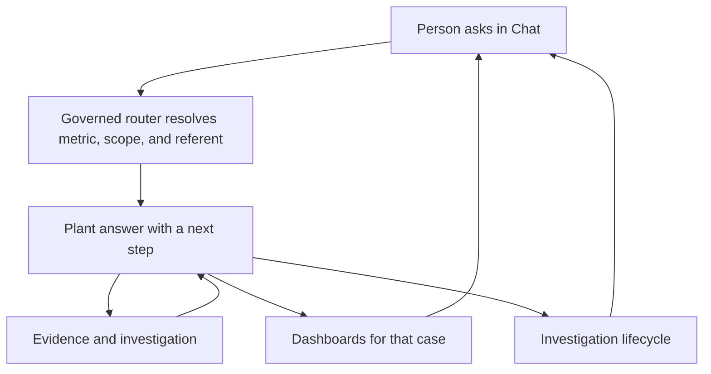

# 03 Using EKAS

Chat is first. Every other area reads the same conversation context.

## Chat first

The composer is labeled Ask EKAS. Send commits a turn and keeps the reply. Suggested starts are “We missed our production goal.”, “Investigate speed.”, “Investigate quality.”, and “Show the plant operating review.”

Pronouns such as Investigate it, Show me, Why?, Open it, What caused it?, and Who owns it resolve in this order:

1. The explicit current or recommended focus from the immediately previous answer.
2. The explicitly selected case or investigation.
3. The active entity or metric from the prior turn.
4. A clarification when more than one valid referent remains.

EKAS does not guess across incompatible cases. A new conversation clears the old referent. An explicit new topic overrides it.

Normal plant answers show a readable time, for example Oct 6, 2026 · 2:45 PM. The exact UTC instant stays under Technical details.

## Plant Review

`Run my plant review.` ranks case shortfalls. The largest absolute good-unit shortfall in the fixture is the Northworks feeder-jam plan miss: 150 good units, 2,154 actual against 2,304 plan. Speed and quality keep their authored plant, Synthetic Works, and are not added to the Northworks miss. `What should I focus on first?` names that same priority. `Investigate it.` opens that case. Line 03 contributed 138 of the 150.

## Dashboards

Dashboards show Plant Operations and Production & OEE for the shared context. The plant shortfall of 150 and the Line 03 contribution of 138 stay labeled as different quantities. Choosing a line and asking Why, or Investigate, returns to Chat and the investigation with that context.

## Investigations

The investigation is the open case: goal, gap, contributor, evidence, hypothesis, action, owner, authorization, performed work, verification, sustain, and reopen. The next button is the next governed step. It does not skip ownership, authorization, or proof.

## Evidence

Each reply can open Evidence and investigation. The plain-language lead is the plant statement. Technical details keep the saved instant, the source ids, and the typed result. A later measurement does not rewrite a saved reply.

## Improvements

Improvements follow the open case. They are not a separate backlog with its own numbers.

## Knowledge

Knowledge is the definition and source material for the selected case. It does not invent a cause the evidence does not state.

## Themes

Light is the default. Dark is under More, “Use dark appearance.” The choice is a local preference.

## Mobile

At 390px and 320px the navigation moves behind Menu. The composer stays on screen. The same case and the same next step remain available.

## Keyboard

Menu, More, and dialogs take keyboard focus. Escape closes the menu or More. Controls are buttons and fields with names, not click-only icons.

## Accessibility

The shell exposes Chat, Dashboards, Investigations, Improvements, and Knowledge as named controls. Answers expose Evidence and investigation. Charts keep a text alternative in the reply and the table. Color is not the only carrier of the shortfall.
