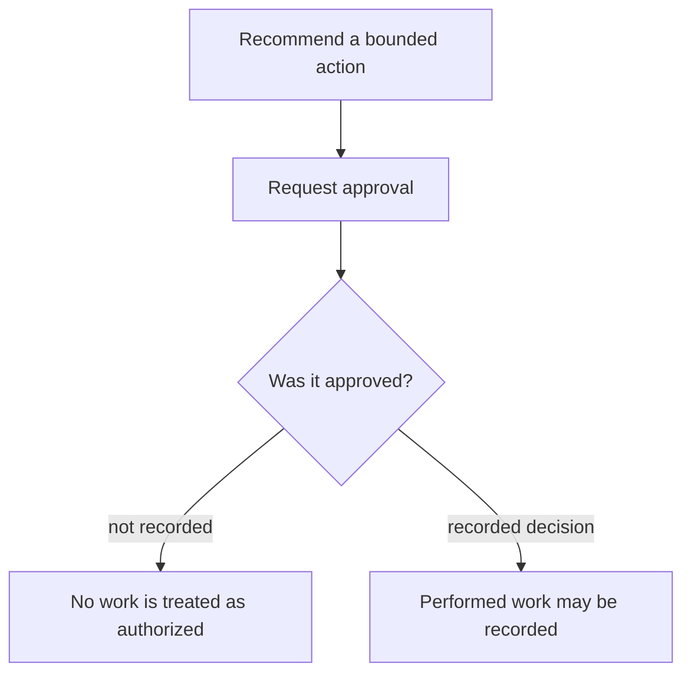
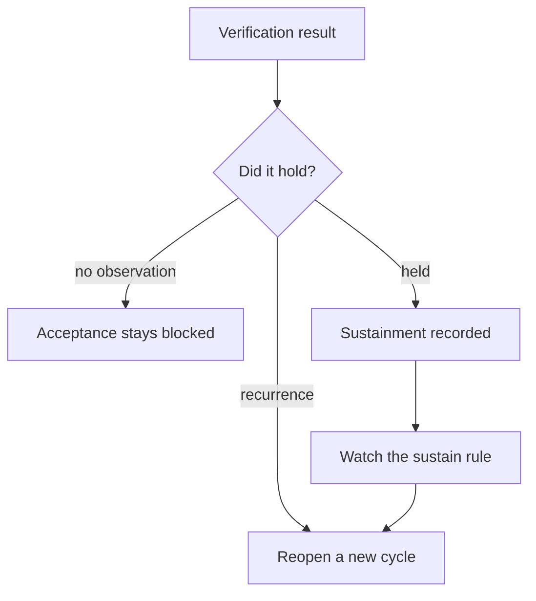

# 04 Journeys

Three accepted journeys share one lifecycle. The prompts are “We missed our production goal.”, “Investigate speed.”, and “Investigate quality.” Each opens its case and can be walked to reopen.

## Downtime

The downtime case is the Northworks feeder-jam plan miss. Plant gap 150 good units. Line 03 contribution 138. The asset in the opened case is FEED-03. The 726-unit theoretical-capacity loss is a different baseline and is not substituted for the 150.

## Speed loss

“Investigate speed.” opens the pressure-recovery speed loss. The speed case keeps its own asset and its own gap. It is not the feeder-jam case.

## Quality / FPY

“Investigate quality.” opens the burr first-pass quality loss. An explicit quality question keeps the pronoun on that quality case. FPY is a first-pass question and is not silently replaced by OEE.

## Authorization

If no approval is recorded, the answer says so. It does not report the action as approved.

## Verification

Verification compares the governed measure with the target after the work. A missing result blocks acceptance. The answer names the block. It does not invent a pass.

## Sustain

## Reopen

Reopen preserves the prior cycle and opens cycle 2. The prior verification is not reused as proof for the new cycle. The next step returns to a new hypothesis.

RC3 frames for these journeys are the `rc3-downtime-*`, `rc3-speed-*`, `rc3-quality-*`, and `rc3-downtime-320-*` screenshots in `docs/wp6/screenshots/`.
