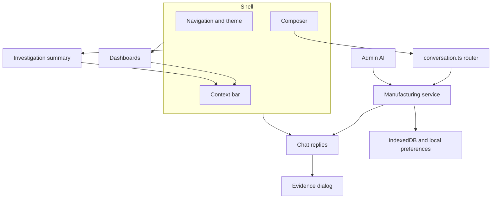
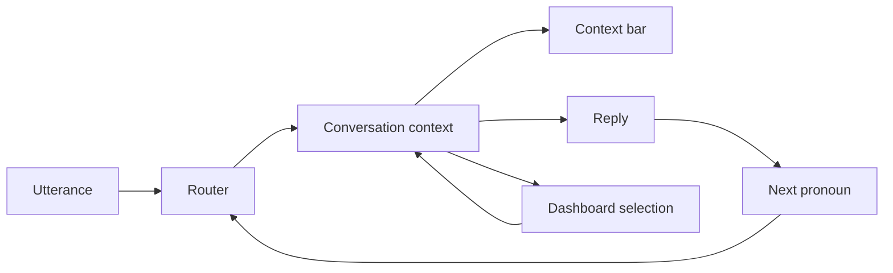
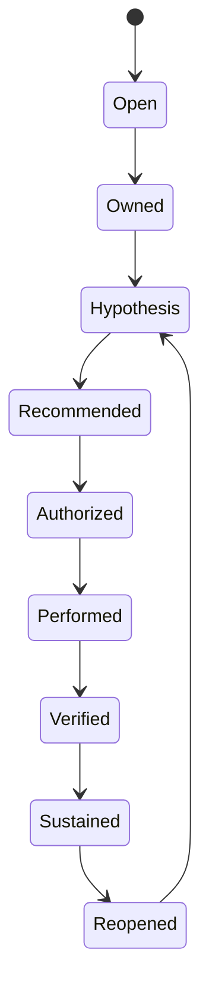
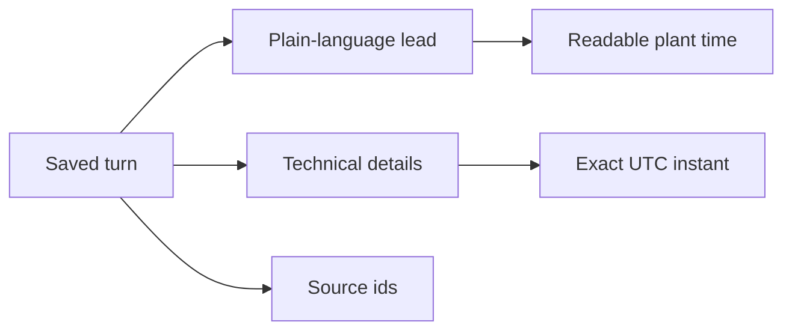

# 05 Frontend architecture

The plant UI is a React application in `app/src`. Chat, dashboards, investigations, evidence, and admin are one shell. The manufacturing service in the browser is the demo authority. A server transport is optional and, in live mode, fail-closed.

## Shell

`CanonicalWorkspace` is the plant shell. Areas are Chat, Dashboards, Investigations, Improvements, and Knowledge. The header carries Notices, Help, Profile, and More. More holds the appearance control. New conversation starts a thread and clears the current referent.

## Chat

A turn is a question plus a saved answer. The reply component renders the plant text, the scorecard when the intent is an audit review, and the evidence control. Presentation formatting of timestamps happens at render. The stored instant does not change.

## Context contract

The context bar shows plant, line, machine, job, period, and case. Those fields come from the conversation context the router wrote. Dashboard selection writes the same context. Chat and Investigation read it back. The contract is one object, not a copy on each screen.

## Conversation state

Each conversation has an id, a version, turns, and the current context. Policy version 8 is stamped on new turns. Older saved turns keep their policy and replay the behavior they were saved with. Policy 7 still clarifies a bare pronoun after Plant Review. `validConversation` stays fail-closed for history that does not match the rules.

## Investigation state

An open case has a stage and a next action. Owner, hypothesis, recommendation, authorization, performed work, verification, sustain, and reopen are stages. The summary region exposes the next control. Cycle 2 after reopen does not inherit cycle 1 proof.

## Evidence model

A reply stores the answer, the as-of instant, the source ids, and the qualification. Evidence and investigation shows the plain lead, the case state, the next action, the scope, and technical details. Technical details include the raw UTC instant. The normal paragraph shows the readable time.

## Dashboards

Plant Operations and Production & OEE use Highcharts. They read the governed gaps. They do not create a second set of totals. Selecting the plant plan miss or a line updates the shared context.

## Metric registry

Metrics have a definition, a unit, a target, and a scope. OEE, availability, performance, quality, FPY, and downtime are not interchangeable. A question that names one does not silently return another. Gaps without an approved target are not ranked as actionable.

## Persistence

Demo conversations persist in IndexedDB. Appearance persists as a local preference. A reload restores the conversation and its referent. A new conversation does not carry the previous referent. The provider key, when one exists, is server-session memory only. It is not in IndexedDB.

## Theme

Light is the default on a fresh profile. Dark is an explicit choice. Both use the same content.

## Role and navigation

The fictional chat role is manager, supervisor, maintenance, safety, or viewer. That role does not grant Admin. Admin requires the local owner session. Navigation does not hide a failed live capability behind an empty chart. The refusal is a sentence.
