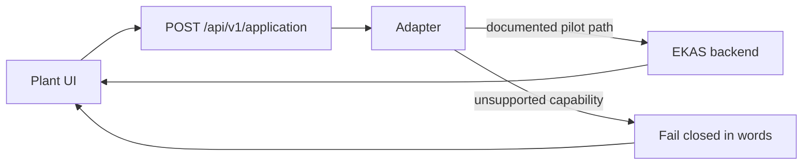
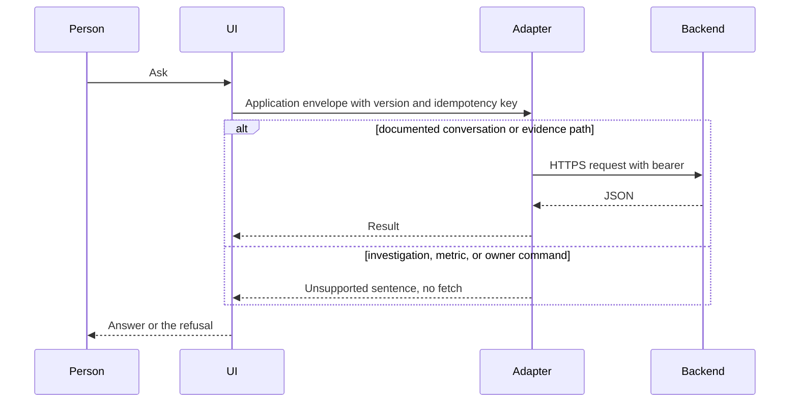

# 06 API and backend integration

Adapter Verified: **NO**. Live Integration Verified: **NO**.

The UI speaks one application envelope to a same-origin server when a server is installed. Demo mode can also run the manufacturing service in the browser. Live mode does not call that browser service as a fallback.

## Envelope

`POST /api/v1/application` with `apiVersion`, `requestId`, `method`, `path`, optional `body`, and optional `idempotencyKey`. The browser does not put a provider key on this call. Credentials for the demo session are the synthetic session cookie. Live bearer tokens are caller-supplied and are not the fictional role name.

Admin is a separate prefix, `/api/v1/admin/`. It requires the local owner cookie and CSRF token. A fictional chat role receives 401.

## UI API contract

The tables below are the contract the UI needs. Where current backend main does not implement it, the live adapter refuses and records nothing. Request and response shapes for the missing investigation commands are the required contract in [14 Production backend gaps](14-production-backend-gaps.md), not routes that exist today.

### Conversation

| Item | Contract |
| --- | --- |
| Purpose | Create a thread and append a turn |
| Request | `POST /api/v1/manufacturing/conversations` and `POST .../conversations/{id}/messages` with `expectedVersion` and text. Pilot live path, where documented: `/v1/conversations` and `/v1/conversations/{id}/messages` |
| Response | Conversation id, version, and the saved turn |
| Scope | The session's allowed assets |
| Auth | Demo synthetic session, or live bearer on the pilot path |
| Version | `expectedVersion` on the message. A stale version conflicts |
| Idempotency | The message idempotency key returns the original outcome for the same key |
| Errors | Invalid request, unauthorized, conflict, dependency unavailable |
| Evidence | The turn stores source ids and the as-of instant |
| Retries | A new explicit request after a failed turn. The same in-flight key is not a second call |
| Unsupported | Live mode does not invent a turn from the synthetic service when the backend is down |

### Metrics

| Item | Contract |
| --- | --- |
| Purpose | Read one governed metric at a scope and period |
| Request | Dedicated metric read: identity, definition version, scope, period |
| Response | Value, unit, target, direction, status, source time, qualification |
| Scope | Named plant, line, or asset. No silent neighbor |
| Auth | Same as the session |
| Version | Definition version on the response |
| Idempotency | Reads are safe to repeat |
| Errors | Unsupported capability, not found, unavailable |
| Evidence | Source refs on the value |
| Retries | Repeat the read. Do not substitute another metric |
| Unsupported | Live mode: "This connected EKAS backend does not currently support a dedicated governed metric read. No metric was fetched." Kernel compute is not this read |

### Evidence

| Item | Contract |
| --- | --- |
| Purpose | Fetch a captured evidence object by content hash |
| Request | Documented pilot path `/v1/evidence/sha256:{64 hex}` |
| Response | The evidence bytes or JSON the hash names |
| Scope | Evidence visible to the session |
| Auth | Live bearer |
| Version | The hash is the identity |
| Idempotency | Repeated GET of the same hash |
| Errors | Forbidden, unavailable, not JSON |
| Evidence | The hash is the provenance |
| Retries | Retry a transport failure. Do not replace the hash |
| Unsupported | A path that is not the documented evidence path is not sent |

### Investigation

| Item | Contract |
| --- | --- |
| Purpose | Create, read, and update the investigation aggregate |
| Request | Investigation id, conversation id, case type, scope, expected version |
| Response | The aggregate: status, owner, hypothesis, recommendation, authorization, performed work, verification, sustain, recurrence, history, evidence refs |
| Scope | The case scope |
| Auth | A principal allowed to change that case |
| Version | `expectedVersion` on every command |
| Idempotency | Command idempotency key |
| Errors | Unsupported, stale version, conflict, not found |
| Evidence | Evidence references on the aggregate |
| Retries | Only with the same key or a new command after the conflict is read |
| Unsupported | Live mode: no investigation was recorded. The call is not sent |

### Owner

| Item | Contract |
| --- | --- |
| Purpose | Request an owner, accept, or reassign |
| Request | Investigation id, expected version, owner identity, idempotency key |
| Response | Owner state: requested, accepted, or unchanged |
| Scope | The case |
| Auth | The actor who may assign |
| Version | Expected version |
| Idempotency | One request key records one request |
| Errors | Unsupported, conflict |
| Evidence | The command is in the history |
| Retries | Do not record a second request under a new key unless the person asked again |
| Unsupported | "No assignment was recorded." Opportunity `responsible_owner` text is not this operation |

### Actions

| Item | Contract |
| --- | --- |
| Purpose | Record a hypothesis and a bounded recommendation |
| Request | Investigation id, expected version, statement, bounds |
| Response | The recorded hypothesis or recommendation |
| Scope | The case |
| Auth | The actor |
| Version | Expected version |
| Idempotency | Command key |
| Errors | Unsupported |
| Evidence | The statement cites evidence ids; it does not create a cause |
| Retries | New explicit command after a refusal |
| Unsupported | The opportunity recommendation is not called and is not relabeled |

### Authorization

| Item | Contract |
| --- | --- |
| Purpose | Request, approve, or reject a bounded action |
| Request | Action id, expected version, decision, actor |
| Response | Decision recorded, or not recorded |
| Scope | The case |
| Auth | The authorizing role, distinct from the chat role |
| Version | Expected version |
| Idempotency | One decision per key |
| Errors | Unsupported, conflict |
| Evidence | The decision references the recommendation |
| Retries | Do not treat a timeout as an approval |
| Unsupported | "No decision was recorded." |

### Performed work

| Item | Contract |
| --- | --- |
| Purpose | Record work that was actually done |
| Request | Action id, expected version, what was done, when |
| Response | The work record, or a refusal |
| Scope | The case |
| Auth | The actor |
| Version | Expected version |
| Idempotency | Command key |
| Errors | Unsupported, conflict |
| Evidence | Work proof is separate from the recommendation |
| Retries | A failed write is not proof the work happened |
| Unsupported | "No work was recorded." |

### Verification

| Item | Contract |
| --- | --- |
| Purpose | Plan and then record the measured result |
| Request | Main measure, baseline, target, observations, guardrails, result |
| Response | Plan, or result, including acceptance or the block |
| Scope | The same scope as the case |
| Auth | The actor |
| Version | Expected version |
| Idempotency | Command key |
| Errors | Unsupported |
| Evidence | Observations cite source time |
| Retries | A missing result stays missing |
| Unsupported | Opportunity verification is not this plan. "No plan was recorded." "No result was recorded." |

### Sustain

| Item | Contract |
| --- | --- |
| Purpose | Record whether the result held under the sustain rule |
| Request | Eligible observations, rule, recurrence threshold |
| Response | Held, blocked, or recurrence |
| Scope | The case window |
| Auth | The actor |
| Version | Expected version |
| Idempotency | Command key |
| Errors | Unsupported |
| Evidence | The observations |
| Retries | Do not mark held without observations |
| Unsupported | "No sustainment was recorded." |

### Reopen

| Item | Contract |
| --- | --- |
| Purpose | Keep the prior cycle and open a new one |
| Request | Investigation id, expected version, reason |
| Response | New cycle id. Prior verification is not the new proof |
| Scope | The same case |
| Auth | The actor |
| Version | Expected version |
| Idempotency | Command key |
| Errors | Unsupported |
| Evidence | History retains cycle 1 |
| Retries | A failed reopen does not create a silent cycle |
| Unsupported | "No cycle was recorded." A boolean `reopened` on another workflow is not this command |

### Health and readiness

| Item | Contract |
| --- | --- |
| Purpose | Tell an operator whether the process is up, separate from whether a capability exists |
| Request | `GET /healthz` and `GET /livez` |
| Response | `status: ok`, `component` `ui-shell-api` or `api-runtime`, and a non-empty `wp` |
| Scope | Unauthenticated probe |
| Auth | None on the probe. This is not a data API |
| Version | The `wp` string |
| Idempotency | Safe to repeat |
| Errors | Any other body is an invalid probe |
| Evidence | None |
| Retries | A probe retry does not enable synthetic fallback |
| Unsupported | Readiness for investigation and metrics is not this shape. A green probe does not mean Adapter Verified |

## Versioning

Application calls send `apiVersion`. Investigation commands require `expectedVersion`. The pilot surface that live mode will send is only the documented conversation and evidence paths. Other paths are refused locally.

## Idempotency

Message and command keys make a repeat of the same operation return the original outcome. A new key is a new attempt and is used only when the person asks again.

## Errors

Invalid request, unauthorized, forbidden, stale authorization, conflict, dependency unavailable, and unsupported capability. Unsupported is local: `UNSUPPORTED_BACKEND_OPERATION`. The UI shows the sentence. It does not fill the screen from the demo service.

## Cross-system records

**DOCUMENTED NOW — NOT YET IMPLEMENTED IN PRODUCTION.**

RC3 does not send these objects and the adapter does not normalize them. The shapes are the contract every important future record has to be able to answer: where did this come from, what does it refer to, when was it true, which version, and how does it connect to other evidence. The field lists and the refusal rules are [Cross-system evidence lineage](cross-system/05-evidence-lineage.md). Missing means missing. Do not infer.

### EvidenceReference

| Field | Contract |
| --- | --- |
| `sourceSystem` | Owning system of record |
| `sourceRecordId` | Id in that system |
| `sourceRecordType` | Record type in that system |
| `sourceVersion` | Version the source assigned |
| `knownAt` | When this integration knew the record. A future instant is not present evidence |
| `effectiveFrom` | Source effectivity start, when the source has one |
| `effectiveTo` | Source effectivity end, when the source has one |
| `controlledStatus` | Source control state. Not invented by EKAS |

### Context

`plantId`, `lineId`, `assetId`, `workCenterId`, `jobId`, `operationId`, `partId`, `revision`, `lotId`, `serialId`, `shift`, `period`.

A canonical id is written only after a governed map resolves it. An unresolved source id stays on the EvidenceReference and is not copied into the canonical context field.

### Lineage

| Field | Contract |
| --- | --- |
| `canonicalEntityId` | Canonical entity when resolution succeeded |
| `relatedEvidenceIds` | Evidence the relationship points at |
| `relationshipType` | A type from the correlation rules. `CAUSED_BY` is never implied |
| `relationshipAuthority` | Governed map, source foreign key, or explicit human assertion |
| `relationshipConfidence` | Only when a governed rule supplies it. Otherwise the field is absent |
| `mappingVersion` | Map version used for the link |

### Reads the UI will need later

These reads are specified and not available. Live mode does not call them.

| Read | Request | Response when missing |
| --- | --- | --- |
| Resolve | `sourceSystem` plus external id | Unresolved. No canonical id is guessed |
| Aliases | `canonicalEntityId` and map version | The source ids the map allows at that version |
| Evidence by context | plant, line, asset, job, part, revision, period | Only records whose context fields are present and match. Absent context does not match "all" |
| Evidence by canonical entity | `canonicalEntityId` | Evidence linked at a governed map version |
| Relationships | entity or evidence id | Descriptive relationships. No automatic cause |
| Effectivity and history | entity, document, and time | The record effective at that time, or an explicit miss |
| Source version | `sourceSystem`, `sourceRecordId`, `sourceVersion` | That version, or a miss. A newer version is not substituted |

## Backend gap contract

The field-level gap against backend main `473bdc0d2458fcffdbe516d220d4f88bcb2f1916` is [14 Production backend gaps](14-production-backend-gaps.md). Deferred production dependency: current EKAS_Platform_v2 main lacks the complete investigation, case, and metrics contract required for full backend-connected EKAS behavior.

## Live integration verification

Not verified. A future live test needs the contract present, the adapter pointed at it, synthetic fallback confirmed off, and an authorized run. Until that run passes, Live Integration Verified stays NO.
