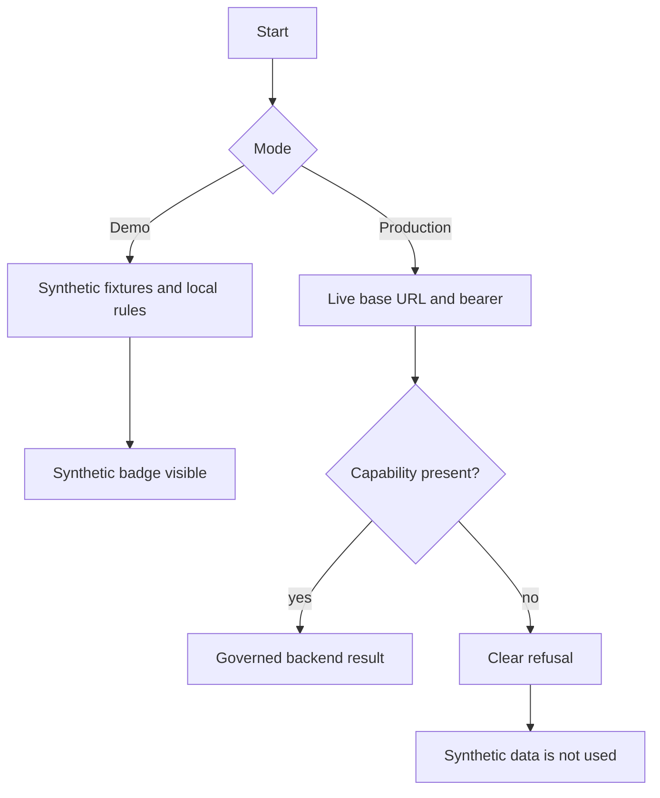

# 07 Demo vs production

Demo mode is the synthetic local product. Production mode is a live backend with synthetic fallback disabled. RC3 ships Demo. It does not ship an accepted Production connection.

## Demo mode

1. Clone the repository and `npm ci` in `app/`.
2. `npm run build` and `npm run dev`, or preview the built files.
3. Leave the provider disconnected, or use the rehearsal owner with a `DUMMY_` credential only. Rehearsal cannot call OpenAI.
4. Confirm the synthetic badge is visible on the context bar.
5. Run an accepted journey: “We missed our production goal.” through the investigation next step, or Plant Review through Investigate it.
6. Reset with **New conversation**. For a full local wipe, remove the browser profile or the demo state directory. Do not delete fixtures.
7. If install fails, remove a symlink at `app/node_modules` and run `npm ci` again. If a proof cannot write `evidence/`, create that directory. If the port is taken, stop the other server.

## Production mode

Do these in order. Stop at the first failure.

1. Disable Demo services. Do not point the plant shell at the in-browser synthetic service.
2. Set the backend base URL. It must be an absolute `http` or `https` URL with no embedded user or password.
3. Set auth as a real bearer. A fictional role name is not a bearer.
4. Set tenant and plant context from the session, not from a hardcoded demo plant.
5. Verify capabilities: conversation, evidence, and each investigation command you intend to call.
6. Check `/healthz` and `/livez`. A green probe is not capability readiness.
7. Run the adapter contract tests against that backend.
8. Confirm synthetic fallback is disabled. A missing capability must return the refusal sentence.
9. Start the UI against that configuration.
10. Run a production smoke test: one known conversation read, one known evidence read, and one unsupported command that must fail in words.

If a capability is missing, the UI fails clearly and does not use synthetic data. The sentences are in `app/src/platform/backendMode.ts`.

## Fail-closed rules

- No base URL or no bearer: live access is unavailable. Demo is not substituted.
- Unsupported investigation, owner, metric, verification, sustain, or reopen path: the call is not sent and nothing is recorded.
- Provider pricing expired, budget missing, or key missing: AI stays disabled. Chat continues on governed local rules only when the shell is still in Demo. Production does not borrow those rules.
- A provider error body is not shown to the plant user and is not parsed into a metric.

## Production checklist

- [ ] Demo service disabled
- [ ] Base URL and bearer set outside the repository
- [ ] Tenant and plant come from the session
- [ ] Health and live probes match the expected component names
- [ ] Adapter contract tests run
- [ ] Synthetic fallback proven off
- [ ] Smoke test recorded
- [ ] Adapter Verified still NO until that evidence is independently accepted

## Same rules in every deployment shape

**DOCUMENTED NOW — NOT YET IMPLEMENTED IN PRODUCTION.**

On-premise, private or air-gapped, cloud, and hybrid are profiles of the production rules above. They keep the same context, the same evidence rules, the same adapter contract, and the same refusal when a capability is missing. They are not separate products. They are not verified by a demo run. The deployment doctrine is [23 Deployment and scale strategy](23-deployment-and-scale-strategy.md). Current release status is tracked in the [release](12-release-and-deployment.md) and [acceptance](09-testing-and-acceptance.md) documentation.
