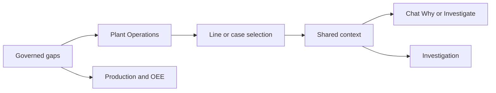

# 08 Dashboards and visualization

Dashboards are a view of the same governed context as Chat. They are not a second source of numbers.

## Plant Operations

The plant card is the Northworks plant plan miss: 150 good units below plan, 2,154 against 2,304. The line table shows contribution. Line 03 contributed 138. Those two figures are not aliases. The card says plant plan miss. The table says line contribution and names the source Production plan and actuals.

Speed and quality gaps that belong to Synthetic Works stay labeled with that plant. They are not added to the Northworks 150.

## Production and OEE

Production and OEE shows the governed OEE components for the selected scope. Highcharts draws the series. The reply and the table still state the figures in text.

## Highcharts standards

Charts use the product font, no remote export server, and local export only. Animation is off. A tooltip may show a point value; the point does not replace the labeled KPI. Credits are off. The chart description states that unavailable values are withheld.

## KPI semantics

A KPI names the measure, the unit, the comparison, and the scope. “Below plan” is an actual-versus-approved-plan gap. Theoretical capacity loss is a different baseline. Percent of target is a different ranking from absolute good-unit shortfall. The plant review uses the absolute shortfall for the recommended case.

## Chart accessibility

The shortfall is in text on the card and in the chat answer. The chart is an additional view. Keyboard users reach the same actions through the named buttons: the plan-miss card, Why, and Investigate.

## Responsive

At desktop widths the KPI row wraps onto two rows with readable type. At 390px and 320px the dashboard remains reachable from Menu. The 150 and 138 labels stay present. Horizontal clipping of the composer is a defect; the phone frames keep the composer on screen.

## Clean-room rule

External dashboard images are research references only. Do not copy their images, layouts, branding, wording, composition, icons, titles, or colors. Take only generic KPI concepts, questions, workflow patterns, and decision-support ideas.
