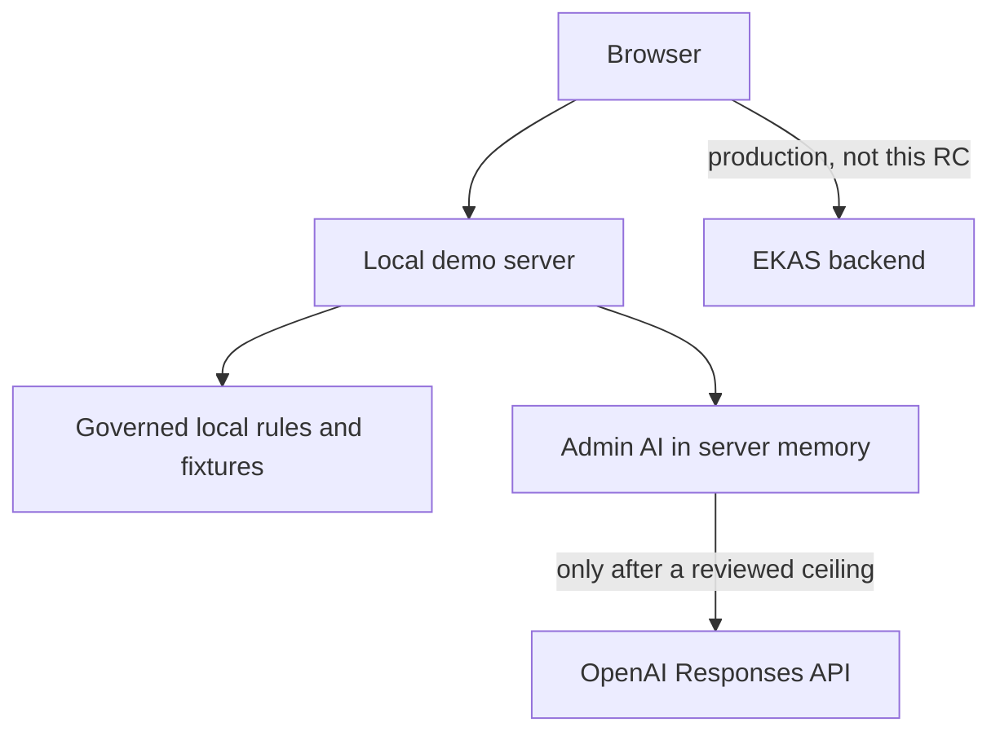
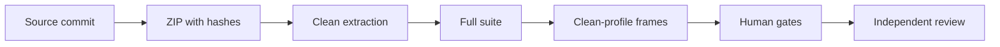

# 12 Release and deployment

## Deployment topology

Demo deployment is a static build plus, when used, `startLocalAiApplicationDemo` on loopback. There is no separate server binary. The server is TypeScript under `app/src/server`.

The RC3 preview used for frames was `vite preview` of the extracted build at `http://127.0.0.1:18195`. That process is not a production host.

Production deployment is specified in [07 Demo vs production](07-demo-vs-production.md) and is not accepted.

## Release process

RC1, RC2, and RC3 each froze a source SHA and a ZIP. Documentation added after the archive does not rewrite the ZIP. Human gates and the final verdict are not simulated by the archive.

## Package rules

The RC3 ZIP excludes the nested RC1 and RC2 archives so the package does not carry previous releases twice. Fixtures, source, and the screenshots that were already tracked stay. `node_modules` and `app/dist` are not in the archive. Member hashes are `docs/wp6/RC3-MEMBERS.sha256`.

## What release does not mean

A green suite is not Adapter Verified and is not Live Integration Verified. PENDING stays until an independent reviewer writes the verdict.

## Plant deployment is a different page

The sections above are the demo package and the release record. Current release status stays in this page and in [09 Testing and acceptance](09-testing-and-acceptance.md).

How a later deployment uses systems the plant already runs, starts from one governed problem, and grows by configuration is [23 Deployment and scale strategy](23-deployment-and-scale-strategy.md). **DOCUMENTED NOW — NOT YET IMPLEMENTED IN PRODUCTION.** That strategy does not make a release package into a verified on-premise, private, cloud, hybrid, or multi-site deployment.
