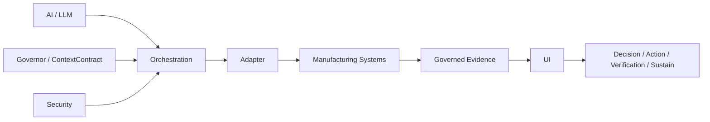

# 15 Architecture decisions

These decisions are already in the running RC3 code. They are recorded so a later change does not treat them as accidents.

## Chat first

The plant leader starts in Chat. Dashboards and investigations are reached from that context. A separate BI state was rejected because the same question would then have two answers.

## One context object

Plant, line, machine, job, period, metric, and case live on the conversation context. Screens read it. They do not keep a private copy that can drift.

## Referent from the conversation, not from the dashboard order

“It” resolves from the previous answer’s recommended focus, then the selected case, then the active metric. It does not default to Quality and it does not take the first card. Ambiguity asks. Policy 8 is the live rule. Older policies stay valid for older captures.

## Absolute shortfall for the recommended case

The recommended plant focus is the largest unique good-unit shortfall, not the largest normalized percent of target. In the fixture that is the feeder-jam miss of 150, with Line 03 at 138.

## Fail closed on the live backend

Unsupported investigation operations are refused in a sentence. The opportunity API is not renamed into the investigation lifecycle. Synthetic fixtures are not a silent production fallback.

## Provider authority is explicit

A model call needs a reviewed price that has not expired, a real cumulative budget, a server-session key, a confirmed test, and Enable. The chat role supplies none of those. RC3’s reviewed price is expired, and the $40 ceiling is not representable, so the call stays off.

## Presentation does not change stored time

Readable times are a view of the stored UTC instant. Technical details keep the instant. Rankings and windows do not move because the label changed.

## Evidence stays with the reply

A saved answer is not rewritten when a later turn learns something else. The as-of instant is part of the reply.

## Manufacturing product context is effectivity-aware

The newest revision is not automatically the correct revision. A historical job binds the revision, controlled definition, and engineering change the source shows were in force at the time of the event. Rev C being newer than Rev B does not move a March job onto Rev C when Rev C becomes effective in May.

**DOCUMENTED NOW — NOT YET IMPLEMENTED IN PRODUCTION.** Effectivity-aware product context is specified in [Product / part identity and PLM context](cross-system/11-product-part-identity-and-plm-context.md) and in the product-context read on [06 API and backend integration](06-api-and-backend-integration.md). The running demo does not resolve PLM effectivity.

## AI operates inside the enterprise architecture

AI is not the architecture. AI is one intelligence component inside a governed manufacturing enterprise architecture. The model or the provider may change without changing manufacturing definitions, the ContextContract, source ownership, evidence, authorization, lifecycle, verification, or the adapter and API contract.

The running demo already keeps a model call off the manufacturing record. Local rules and the case state answer the accepted journeys. See [05 Frontend architecture](05-frontend-architecture.md) and [06 API and backend integration](06-api-and-backend-integration.md).

**DOCUMENTED NOW — NOT YET IMPLEMENTED IN PRODUCTION.** The path from orchestration through the adapter into manufacturing systems, and back through governed evidence, is the target architecture. It is not a verified live integration. Adapter Verified remains NO.

