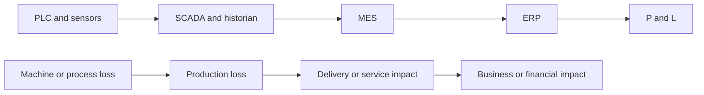

# 17 PLC to P&L strategy

The chain from a machine signal to a financial statement is a chain of different claims. EKAS keeps them distinct.

## Three quantities that are not the same

| Quantity | Meaning |
| --- | --- |
| Observed loss | What the governed record shows was missed: units, time, or yield, with a source and a time |
| Modeled opportunity | A scenario of what might be recovered if a cause were removed. It is not cash |
| Verified financial value | A finance-accepted figure tied to an actual result |

Observed loss is not modeled opportunity. Modeled opportunity is not verified financial value. Never call modeled opportunity “savings.”

## How EKAS uses the chain

A feeder jam is a machine or process loss. The 150 good units below plan are a production loss. Delivery impact and financial impact are further claims and need their own evidence. The investigation can recommend an action and verify the production result. It does not print a savings number from the unit gap.

## Where EKAS sits

EKAS reads across this chain to interpret and to govern the decision. The systems in the chain remain the systems of record for their own data. See [18 MES boundary](18-mes-boundary.md).

## Cross-system chain

**DOCUMENTED NOW — NOT YET IMPLEMENTED IN PRODUCTION.**

The production chain this package joins, and does not replace, is PLC and sensors, then SCADA and the historian, then MES, QMS, and CMMS, then ERP, then finance and the P&L. The join is governed identity and evidence lineage, specified in [Cross-system context](cross-system/01-cross-system-manufacturing-data.md). Observed loss is not modeled opportunity. Modeled opportunity is not verified financial value. Retrieving an ERP cost beside an MES quantity does not create verified financial value.

## From the machine to a verified financial outcome

**DOCUMENTED NOW — NOT YET IMPLEMENTED IN PRODUCTION.**

[22 EKAS Manufacturing AI Maturity Model](22-manufacturing-ai-maturity-model.md) reads this chain as layers that have to be earned. Connect and collect sit with the PLC, the sensors, SCADA, and the historian. Integrate is the governed join across MES, QMS, CMMS, and ERP. Understand and reason may explain the loss. Optimize may describe a modeled opportunity. Orchestrate may carry the [decision execution model](21-decision-execution-model.md). The figure at the end of the chain is verified financial value only when finance accepts it.

Financial proof stays outside model ownership. The model may explain a unit gap. It does not certify the financial outcome. Observed loss, modeled opportunity, and verified financial value remain three quantities. A modeled opportunity is not verified savings.

## Existing systems, then proof

**DOCUMENTED NOW — NOT YET IMPLEMENTED IN PRODUCTION.**

[23 Deployment and scale strategy](23-deployment-and-scale-strategy.md) starts from the systems a plant already runs. A pilot may identify an opportunity on this chain. Verified financial value still requires an implemented change, a verified operational result, and finance evidence. Expanding to another line or site does not convert a modeled opportunity into that figure.
