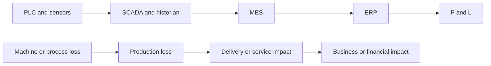

# 17 PLC to P&L strategy

The chain from a machine signal to a financial statement is a chain of different claims. EKAS keeps them distinct.

## Three quantities that are not the same

| Quantity | Meaning |
| --- | --- |
| Observed loss | What the governed record shows was missed: units, time, or yield, with a source and a time |
| Modeled opportunity | A scenario of what might be recovered if a cause were removed. It is not cash |
| Verified financial value | A finance-accepted figure tied to an actual result |

Observed loss is not modeled opportunity. Modeled opportunity is not verified financial value. Never call modeled opportunity “savings.”

## How EKAS uses the chain

A feeder jam is a machine or process loss. The 150 good units below plan are a production loss. Delivery impact and financial impact are further claims and need their own evidence. The investigation can recommend an action and verify the production result. It does not print a savings number from the unit gap.

## Where EKAS sits

EKAS reads across this chain to interpret and to govern the decision. The systems in the chain remain the systems of record for their own data. See [18 MES boundary](18-mes-boundary.md).
