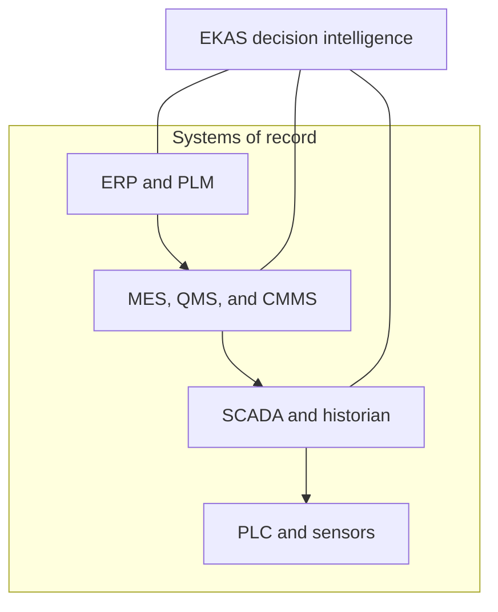

# 18 MES boundary / execution data model

MES executes and records. EKAS interprets, connects evidence, governs decisions, and verifies outcomes.

The map from the top of the business systems to the device is ERP and PLM, then MES, QMS, and CMMS, then SCADA and the historian, then PLC and sensors. EKAS sits across and above that stack. It is not a box that replaces any of them.

## What stays in MES

Orders, execution state, genealogy as the execution system records it, and the transactions MES commits. EKAS does not become the writer of those transactions in this demo, and the doctrine does not make it the writer in production.

## What EKAS adds

A conversation that ties a missed goal to the evidence the systems already hold, a named owner, an authorization, a record of work, a verification, and a sustain or reopen decision. If the evidence is not in the record, EKAS says it is not supplied.

## Boundary rules

- Do not claim EKAS replaces MES.
- Do not copy an execution status into EKAS and then treat the copy as more authoritative than MES.
- Do not calculate a financial saving from a unit gap inside the conversation and present it as verified value.
