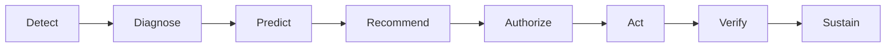

# 21 Decision execution model

## Executive model

Detect → Diagnose → Predict → Recommend → Authorize → Act → Verify → Sustain

This is the executive simplification. It does not replace the detailed lifecycle.

Predict is optional. Do not force prediction where evidence does not support it.

Recommendation ≠ authorization. Authorization ≠ performed work. Performed work ≠ verification. Verification ≠ sustainment.

Predict is on the diagram so the stage can be named. A case goes from Diagnose to Recommend when the evidence does not support a prediction. The arrow through Predict is not an instruction to invent one.

**DOCUMENTED NOW — NOT YET IMPLEMENTED IN PRODUCTION.** Predict is not a running production capability. Cross-system diagnosis, effectivity-aware product context, orchestration of Act into a source system, and governed autonomy are not running production capabilities either.

| Executive stage | What it is for |
| --- | --- |
| Detect | See the missed goal or the loss |
| Diagnose | Separate the contributor, the evidence, and the hypothesis. Name what is missing |
| Predict | Optional. A bounded statement of what may happen next, and only when the evidence supports it. A prediction is not a cause and not a recommendation |
| Recommend | Propose a bounded action |
| Authorize | A named authority approves or withholds that action. The recommendation does not authorize itself |
| Act | Record work that was actually done. Authorization is not that record. The source system still owns the work it executes |
| Verify | Compare the governed measure with the target after the work. Performed work is not verification. A missing result blocks acceptance |
| Sustain | Decide whether the verified result held. Verification is not sustainment |

## Detailed lifecycle

The detailed lifecycle remains:

Goal → Gap → Loss → Contributor → Evidence → Hypothesis → Action → Owner → Authorization → Performed Work → Verification → Sustain → Reopen

That sequence is the journey in [04 Journeys](04-journeys.md), the investigation in [03 Using EKAS](03-using-ekas.md), and the state machine in [05 Frontend architecture](05-frontend-architecture.md). The executive model is a shorter reading of those steps. It does not delete Reopen, Owner, or any other detailed step. Predict is the one executive stage the detailed lifecycle does not force.

## Mapping

| Executive stage | Detailed lifecycle steps |
| --- | --- |
| Detect | Goal, Gap, Loss |
| Diagnose | Contributor, Evidence, Hypothesis |
| Predict | None. Predict is optional. It is not inserted into the detailed lifecycle when the evidence does not support it |
| Recommend | Action |
| Authorize | Owner, Authorization |
| Act | Performed Work |
| Verify | Verification |
| Sustain | Sustain. Reopen stays in the detailed lifecycle when the result does not hold and a new cycle starts |

## Synthetic demo

The synthetic demo exercises workflow concepts corresponding to the detailed lifecycle. It does not establish production maturity at the executive stages, and it does not establish Predict. `docs/integration/BACKEND-CONTRACT.md` records the local separation of goal, loss, evidence, hypothesis, action, owner acceptance, authorization, performed work, verification, sustainment, and reopen. The same record states that decision-support writes do not release production or dispatch work.

## What stays in the source system

MES executes and records. CMMS records the maintenance work it owns. QMS records the disposition it owns. EKAS holds the decision context that cites those records. See [18 MES boundary](18-mes-boundary.md).

**DOCUMENTED NOW — NOT YET IMPLEMENTED IN PRODUCTION.** Coordinating Act, Verify, or Sustain across live MES, CMMS, QMS, ERP, PLM, SCADA, or the historian is not implemented. [14 Production backend gaps](14-production-backend-gaps.md) marks the investigation aggregate and its commands MISSING on the inspected backend. Orchestration in [22 EKAS Manufacturing AI Maturity Model](22-manufacturing-ai-maturity-model.md) means coordinating these stages under governance. It does not mean replacing the system that owns the work.

## How a later layer may use the model

No executive stage skips backward to invent a missing record. Governed autonomy, if a plant ever authorizes a bounded class of action, still passes Authorize, source-system confirmation, and Verify. The maturity rules are on [page 22](22-manufacturing-ai-maturity-model.md). **DOCUMENTED NOW — NOT YET IMPLEMENTED IN PRODUCTION.**
