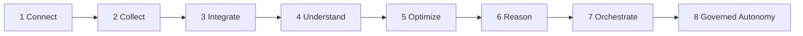

# EKAS Manufacturing AI Maturity Model

AUTONOMY MUST BE EARNED LAYER BY LAYER.

EKAS does not skip from connected data to autonomous action. Integration, evidence, governance, authorization, orchestration, and verification must exist first.

**DOCUMENTED NOW — NOT YET IMPLEMENTED IN PRODUCTION.** Predictive optimization, cross-system integration, effectivity-aware product context, orchestration into source systems, and governed autonomy are specified on this page. They are not running production capabilities. Writing the model does not authorize an action.

## 1 Purpose

This is a capability-maturity model for manufacturing AI. It describes what a process is able to do with governed data, and what must already be true before the next layer is honest.

It is not a product-version ladder. RC3, RC5, and RC6 are release candidates of this demo. They are not maturity levels. A higher release number does not mean a higher level.

It is not permission to automate an unsafe action or an unauthorized action. A plant may judge that a process should remain human-authorized. That judgment is a successful use of the model.

The levels below are the only order this page recognizes. Each level assumes the levels before it for the same process. A dashboard, a model, or a pilot that cannot show the earlier level has not reached the later one.

## 2 Level 1 — Connect

Purpose. A named system, device, or signal can be reached under an authorized connection. The connection has an owner, a scope, and a failure that is visible.

Example. An authorized session can address a historian endpoint, a MES interface, or a PLC-fed SCADA tag. The session being up is not a quantity, a cause, or an approval.

EKAS relevance. The demo connects a plant leader to a local synthetic service. [06 API and backend integration](06-api-and-backend-integration.md) separates that demo path from a live backend. Live Integration Verified is NO. A green health probe is not a connection to a plant system.

## 3 Level 2 — Collect

Purpose. Records are captured and kept as the source produced them, with source identity and source time. Collection does not interpret the record into a decision.

Example. A downtime event, a good-unit count, a tag sample, or a maintenance note, each stored with the timestamp the source gave it. A missing sample stays missing.

EKAS relevance. The demo collects synthetic fixture facts. [01 Overview](01-overview.md) names the Northworks plan miss of 150 good units and the Line 03 contribution of 138 as fixture facts. [13 Current limitations](13-current-limitations.md) states that the data is synthetic and is not a live historian. Collection in the demo is not plant data collection.

## 4 Level 3 — Integrate

Purpose. Records from more than one system can be used in one decision only through a governed identity map, effectivity, and evidence lineage. Similar names are not a join.

Example. MES `LINE03_FEEDER`, CMMS `ASSET-4712`, and historian `PLC_FEED_03` may be read together as canonical `FEED-03` only when the governed map says so. Part 100-2045 Rev B and Rev C stay apart unless effectivity binds one of them to the event. See [cross-system identity](cross-system/03-canonical-ekas-identity-model.md) and [product and PLM context](cross-system/11-product-part-identity-and-plm-context.md).

EKAS relevance. **DOCUMENTED NOW — NOT YET IMPLEMENTED IN PRODUCTION.** The cross-system section states the contract. [14 Production backend gaps](14-production-backend-gaps.md) marks resolve, alias, effectivity, and source-version lookup MISSING. Adapter Verified remains NO.

## 5 Level 4 — Understand

Purpose. A person can see what happened, in which scope, against which definition, with the evidence cited and the unknown named. Understanding explains the governed record. It does not create a new actual.

Example. The plant missed plan by 150 good units. Line 03 contributed 138. The recommended case is the feeder-jam miss. Speed and quality remain their own cases. An absent maintenance record is reported as absent.

EKAS relevance. The accepted demo journeys do this on synthetic fixtures with local governed rules. [03 Using EKAS](03-using-ekas.md) and [04 Journeys](04-journeys.md) are that behavior. It is not evidence that a model discovered a cause in a live plant.

## 6 Level 5 — Optimize

Purpose. A bounded opportunity can be studied. The measure, the scope, the assumption, and the scenario stay visible. The study asks what might change if a stated condition changed.

Example. A scenario about the feeder-jam unit gap: how many of the 150 good units sit on that case, and what a later verification would have to measure. The scenario is a modeled opportunity.

EKAS relevance. [17 PLC to P&L strategy](17-plc-to-pl-strategy.md) keeps observed loss, modeled opportunity, and verified financial value apart. This level may describe a modeled opportunity. It does not report savings, and it does not authorize the change. **DOCUMENTED NOW — NOT YET IMPLEMENTED IN PRODUCTION.** Predictive optimization against live source systems is not a running capability.

## 7 Level 6 — Reason

Purpose. A model may interpret, synthesize, explain, and propose from governed context that earlier levels have already bound.

Authoritative metrics, evidence truth, authorization, performed work, verification, and financial proof stay with their owners. The model does not own them. A proposal is not a cause, not an approval, not a record that work was done, and not a financial result.

Example. A hypothesis for the feeder jam, written as a proposal, with the evidence ids beside it. The next human step is still authorization. The proposal does not change the 150 or the 138.

EKAS relevance. Accepted demo answers come from local governed rules, not from a provider call. [13 Current limitations](13-current-limitations.md) records that the saved pricing authority expired and that paid testing is blocked. `docs/wp6/RC5-PROVIDER-POLICY.md` records that no paid call was made, and that the LLM does not own OEE, metrics, evidence, authorization, case state, verification, sustain, identity, lineage, or financial proof. `docs/wp6/RC6-IDENTITY.md` records that no real provider call was made. Level 6 is not the running path of this demo.

## 8 Level 7 — Orchestrate

Purpose. Coordinate governed decision execution across the people and the records that have to move together. Source systems remain the systems of record. Orchestration requests, tracks, and cites. It does not become MES, CMMS, QMS, ERP, or PLM.

Example. The case names an owner, records an authorization, and leaves the maintenance work order in CMMS and the execution status in MES. EKAS holds the decision aggregate: which recommendation was authorized, which evidence was cited, and whether verification has a result. See [21 Decision execution model](21-decision-execution-model.md).

EKAS relevance. The synthetic investigation coordinates the next step inside the demo. [05 Frontend architecture](05-frontend-architecture.md) shows that state machine. Live investigation commands are MISSING in [14 Production backend gaps](14-production-backend-gaps.md). **DOCUMENTED NOW — NOT YET IMPLEMENTED IN PRODUCTION.** Orchestration across live source systems is not implemented. `docs/integration/BACKEND-CONTRACT.md` records that decision-support writes do not release production or dispatch work.

## 9 Level 8 — Governed Autonomy

Purpose. A previously authorized class of action may proceed inside a bound, and must stop when a condition of that bound fails.

This level is governed autonomy. The unqualified phrase "autonomous operations" is not a name this page uses and is not a state EKAS claims.

All of the following are required before a single action in that class may proceed:

| Requirement | What has to be true |
| --- | --- |
| Explicit authority | A recorded authorization names the class of action, the actor, and the limit |
| Bounded scope | Plant, line, asset, part, revision, and time window are explicit. A neighboring scope is out of bounds |
| Safety constraints | The bound names the conditions that force a stop |
| Auditable path | The request, the authority, the source records, and the result can be reconstructed |
| Fail-safe | A missing input, a failed source, or a failed check stops the action |
| Source-system confirmation | The system that owns the fact confirms the write or the command. A copy inside EKAS is not confirmation |
| Verification | The governed measure is compared with the target after the action. A missing result is not a pass |
| Rollback or recovery | The bound names how to undo or how to recover, and who confirms it |
| Human override | A person can stop the class of action. The stop is recorded |
| No silent escalation | A wider scope, a different part revision, or a larger consequence requires a new authorization |

Level 8 is not automatically the goal. Some processes stay human-authorized by design. A safety action, a financial posting, a deviation, or a release of a revision can remain at recommend-and-wait for as long as the plant decides. Reaching level 7, or writing this page, does not promote those processes.

EKAS relevance. **DOCUMENTED NOW — NOT YET IMPLEMENTED IN PRODUCTION.** No page in this wiki, and no release note cited below, records an implemented governed-autonomy action. This level authorizes nothing by itself.

## 10 How the levels relate

The arrow means "only after." It does not mean every process should travel to level 8. A process may stop at the level the plant chooses to earn, and stay there.

## 11 Governance across all levels

Governance is not a gate that appears at level 8. Evidence, authorization, and provenance have a job at every level. A later level inherits the earlier duties and adds its own.

| Level | Governance | Evidence | Authorization | Provenance |
| --- | --- | --- | --- | --- |
| 1 Connect | The connection is named, scoped, and owned | A connection is not a manufacturing fact | A principal is allowed to open that connection | The endpoint's system identity is recorded |
| 2 Collect | Captured records are retained as captured | The source payload is the evidence | A principal is allowed to collect from that source | `sourceSystem`, `sourceRecordId`, source time, and `knownAt` |
| 3 Integrate | Joins require a governed map and effectivity | Unresolved and conflicting identities stay unresolved | A principal is allowed to assert or to use a map version | `mappingVersion`, `sourceVersion`, `effectiveFrom`, `effectiveTo` |
| 4 Understand | The answer cites what was used and what was missing | Source ids and the as-of instant stay on the reply | The reader sees the record. Understanding grants no action | The reply is not rewritten when a later fact arrives |
| 5 Optimize | Assumptions and scope are part of the scenario | The scenario cites the observed loss it started from | Studying an opportunity does not approve it | Modeled opportunity stays labeled as a model |
| 6 Reason | The proposal is marked as a proposal | The model cites governed context. It does not mint evidence | The model does not authorize | Metric definitions, case state, and financial proof keep their owners |
| 7 Orchestrate | Each stage of the decision is a separate record | The case cites the records the stage used | Authorization is a recorded stage, distinct from recommendation and from work | Expected version and idempotency on every command. Source systems keep their own records |
| 8 Governed Autonomy | The bound is explicit, fail-safe, and overridable | Source-system confirmation and verification are both required | The class of action was authorized before it ran. Silent escalation is refused | The auditable path includes the stop, the rollback, and the human override |

Cross-system identity, effectivity, and lineage at levels 3 and above are **DOCUMENTED NOW — NOT YET IMPLEMENTED IN PRODUCTION.**

## 12 Relationship to the decision execution model

[21 Decision execution model](21-decision-execution-model.md) is the sequence a case walks. The maturity levels say which of those stages a process is ready to support. A level does not skip a stage.

| Maturity level | Decision-execution stages it can support | What it must not do |
| --- | --- | --- |
| 1 Connect | None. A connection is not a loss and not a decision | Treat a successful login or probe as a plant result |
| 2 Collect | None. A stored record is not yet a case | Infer a gap from an untitled payload |
| 3 Integrate | Bind context, once identity and effectivity resolve | Merge similar names, or apply the newest revision to a historical job |
| 4 Understand | Recognize the loss, bind context, and cite evidence | Invent a cause, an owner, or a result |
| 5 Optimize | Study a bounded recommendation as a scenario | Authorize the action, or call the scenario savings |
| 6 Reason | Interpret evidence and propose a hypothesis or a bounded action | Own the metric, the evidence, the authorization, the performed work, the verification, or the financial proof |
| 7 Orchestrate | Coordinate owner, authorization, performed-work citation, verification, and sustain or reopen | Replace MES, CMMS, QMS, ERP, or PLM as the writer of their facts |
| 8 Governed Autonomy | Proceed with one previously authorized class of action inside its bound, then verify | Run an unqualified autonomous operation, escalate silently, or skip verification |

The demo's synthetic journeys already walk the stages in the level 4 through level 7 rows inside the local case. That is the journey in [04 Journeys](04-journeys.md). It is not a claim that levels 3, 5, 6, 7, or 8 have been earned against live systems.

## 13 Relationship to the EKAS lifecycle

The detailed lifecycle this wiki documents is the journey on [04 Journeys](04-journeys.md):

goal, gap, loss, contributor, evidence, hypothesis, action, owner, authorization, performed work, verification, sustain, reopen.

[03 Using EKAS](03-using-ekas.md) states the same lifecycle for the investigation. [05 Frontend architecture](05-frontend-architecture.md) is the state machine the shell exposes. [16 Claim to fame](16-claim-to-fame.md) states the doctrine form: from a missed operating goal to evidence, a governed decision, accountable action, verification, and sustained improvement.

| Lifecycle step | Earliest maturity that can support it honestly | Rule this wiki already states |
| --- | --- | --- |
| Goal, gap, loss, contributor | Understand, and Integrate when the facts come from more than one system | The 150 plant shortfall and the 138 line contribution stay different quantities |
| Evidence | Understand, on top of Collect, and Integrate when more than one source is cited | A missing record stays missing |
| Hypothesis, action | Reason may propose. Optimize may frame the scenario | The recommendation does not create a cause |
| Owner, authorization | Orchestrate, with governance | No recorded approval means the work is not treated as authorized |
| Performed work | Orchestrate. The source system records the work it owns | Performed work is not the recommendation |
| Verification | Orchestrate. Governed autonomy still stops here until a result exists | A missing result blocks acceptance |
| Sustain, reopen | Orchestrate | Reopen keeps the prior cycle. Prior verification is not the new proof |

Loss, investigation, action, verification, and sustain are that same chain. A maturity assessment that cannot point at the lifecycle step it claims to cover has not named a real capability.

## 14 Current EKAS position

A production maturity level is not assessable from this repository. Adapter Verified is NO. Live Integration Verified is NO. Those statements are [06 API and backend integration](06-api-and-backend-integration.md) and [14 Production backend gaps](14-production-backend-gaps.md). This section does not assign level 1 through level 8 as achieved.

What the documents support:

| Claim that the documents support | Where |
| --- | --- |
| The accepted demo description in the wiki is EKAS DEMO RC3 on synthetic fixtures. Chat runs on governed local rules. The 150 and the 138 are fixture facts | [01 Overview](01-overview.md) |
| Three journeys share one lifecycle and can be walked to reopen on that synthetic case | [04 Journeys](04-journeys.md) |
| The synthetic investigation lifecycle is implemented for the supplied cases. Decision-support writes do not release production or dispatch work. `Governor` and `ContextContract` are not imported by this UI | `docs/integration/BACKEND-CONTRACT.md` |
| The data is synthetic. Paid provider testing is blocked because the saved pricing authority expired | [13 Current limitations](13-current-limitations.md) |
| The investigation aggregate and its commands are MISSING on the inspected backend. Cross-system reads are documented and not implemented | [14 Production backend gaps](14-production-backend-gaps.md) |
| RC5 recorded no paid provider call. The LLM does not own OEE, metrics, evidence, authorization, case state, verification, sustain, identity, lineage, or financial proof | `docs/wp6/RC5-PROVIDER-POLICY.md` |
| RC6 is not frozen. Demo Complete is not claimed. No real provider call was made. Adapter Verified remains NO. Live Integration Verified remains NO | `docs/wp6/RC6-IDENTITY.md` |

What is not claimed, because this repository does not verify it:

- A live connection to a PLC, historian, MES, CMMS, QMS, ERP, or PLM.
- Collection of plant data.
- Cross-system integration, including effectivity for part 100-2045 or any other part.
- A running provider model that reasons over plant context.
- Orchestration that writes to a source system.
- Any governed-autonomy action.
- A single sentence of the form "EKAS is at level N."

The demo is evidence of a synthetic, human-paced decision workflow. It is not evidence that the maturity layers have been earned in production.

## 15 Customer and commercial interpretation

A plant can use the model to self-assess one process at a time, and to plan the next layer. The assessment names a process, such as the response to a feeder jam or a first-pass quality loss, and asks:

1. Which systems does this process actually reach, and who is allowed to connect?
2. Which records are collected, and do they keep source time?
3. Which identities are governed, and which effectivity windows are proven?
4. Can a person explain the loss from those records, including what is missing?
5. If a scenario exists, is it labeled as a modeled opportunity?
6. If a model proposes an action, who still authorizes it?
7. Who records the work in the system that owns the work, and what measurement verifies it?
8. Is any step proposed for governed autonomy? If so, which bound, which stop, and which human override exist today?

The honest result is often a split. Connectivity at a machine can be level 1 or 2 while the decision to change the process is still human-authorized at level 4. That split is a plan, not a failure.

The plan names the missing layer. It does not skip to an autonomous action because a tag is connected. Commercial conversation about the plan stays inside the three quantities in [17 PLC to P&L strategy](17-plc-to-pl-strategy.md). Observed loss is not a savings figure. A modeled opportunity is not verified savings. Verified financial value waits on finance.

## 16 Architecture decision

Autonomy must be earned. The same decision is recorded in [15 Architecture decisions](15-architecture-decisions.md).

Connected data, a collected archive, an integrated map, an explanation, a scenario, and a proposal are each real capabilities. None of them is authority to act. Orchestration comes after those layers and still leaves the source system in place. Governed autonomy, when a plant wants it at all, comes after orchestration and still requires the bound in section 9.

## 17 Claim to fame

[16 Claim to fame](16-claim-to-fame.md) says EKAS takes a plant leader from a missed operating goal to evidence, a governed decision, accountable action, verification, and sustained improvement, through a conversation.

That sentence is a lifecycle claim. It matches levels 4 through 7 when the evidence is real, and it matches the synthetic demo when the evidence is the fixture. It does not require level 8. The model can change. The manufacturing truth, the governance, the evidence chain, and the user workflow must not. Those sentences are on page 16. This model is how they stay true when a more capable model is introduced: the new model may interpret and propose, and the earlier levels still own the record.

## 18 PLC to P&L

[17 PLC to P&L strategy](17-plc-to-pl-strategy.md) is the chain from the machine to a financial statement, and the rule that the claims along that chain are different.

| Place on the chain | Maturity layer | What remains outside the model |
| --- | --- | --- |
| PLC, sensors, SCADA, historian | Connect and collect | The sample and its source time |
| MES, QMS, CMMS, ERP, PLM | Integrate | Each system's own fact, including effectivity and cost |
| Explaining the loss | Understand and reason | The metric definition and the evidence |
| A scenario of recovered units | Optimize | The label "modeled opportunity" |
| Owner, authorization, work, verification, sustain | Orchestrate | The source system's record of the work |
| Finance-accepted result | After verification, and only with finance | Verified financial value. The model does not own this proof |

**DOCUMENTED NOW — NOT YET IMPLEMENTED IN PRODUCTION.** The live chain from a PLC to a verified financial outcome is not implemented. Retrieving an ERP cost beside an MES quantity does not create that outcome.

## 19 Future dashboard UX

**DOCUMENTED NOW — NOT YET IMPLEMENTED IN PRODUCTION.**

A later dashboard could show maturity context for the selected case. The current dashboards are specified in [08 Dashboards and visualization](08-dashboards-and-visualization.md). They show governed gaps. They do not show a level.

A future view could, for the case already in context, answer four questions in plant language:

- Which sources are connected for this case, and which were asked and unavailable?
- Which records were collected, with their source time?
- Whether identity and effectivity resolved, or whether the case is unresolved or ambiguous.
- Whether authorization, performed work, and verification exist as records, or are still missing.

The view would not show an autonomy score, a plant ranking by level, or a savings number derived from the level. Color would not be the only carrier. The same facts would remain in the chat answer, because dashboards stay a view of the same context. This presentation is future work. It is not on Plant Operations or Production & OEE.

## 20 Production-status caveats

- This page does not change product source, adapter runtime, chat, dashboards, or a release artifact.
- It does not create a release candidate, and it does not freeze RC6. `docs/wp6/RC6-IDENTITY.md` already says RC6 is not frozen.
- Release-candidate numbers and maturity levels are different scales.
- Adapter Verified remains NO. Live Integration Verified remains NO. Demo Complete is not claimed.
- Every cross-system, predictive, orchestration, PLM, effectivity, and governed-autonomy statement on this page is **DOCUMENTED NOW — NOT YET IMPLEMENTED IN PRODUCTION.**
- A process that the plant keeps under human authority is inside the model, not behind it.

## 21 Deliverables and final quality bar

A reader who has used this page with [15 Architecture decisions](15-architecture-decisions.md), [16 Claim to fame](16-claim-to-fame.md), [17 PLC to P&L strategy](17-plc-to-pl-strategy.md), and [21 Decision execution model](21-decision-execution-model.md) should be able to answer:

1. What each of the eight levels is for, and why the order is mandatory.
2. Why a connected tag is not an autonomous action.
3. What a model may do at level 6, and which records it does not own.
4. What level 8 requires, and why some processes stay human-authorized.
5. How the levels sit on the journey from loss to verification and sustain.
6. How the levels sit on the chain from the PLC to a finance-accepted figure, and why a modeled opportunity is not verified savings.
7. What this repository actually shows about EKAS today, and which levels are not claimed.
