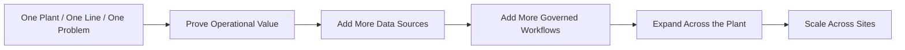
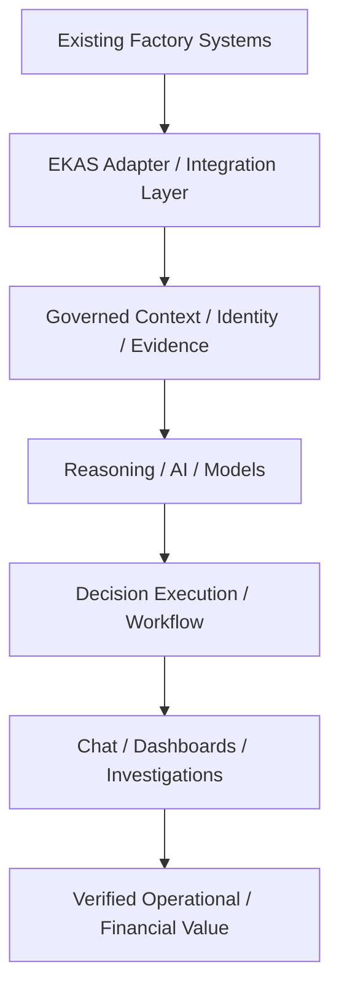
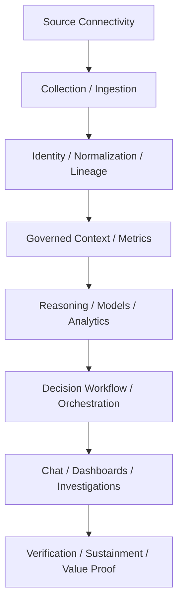
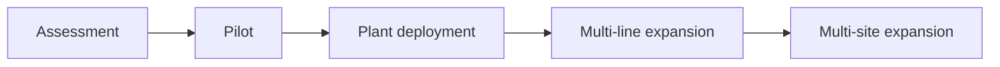

# EKAS Deployment and Scale Strategy

DO NOT REQUIRE A PLANT TO REPLACE WORKING SYSTEMS TO GET VALUE FROM EKAS.

LAND WITH ONE GOVERNED PROBLEM. EXPAND BY ADDING SOURCES, WORKFLOWS, ASSETS AND SITES WITHOUT CHANGING THE CORE ARCHITECTURE.

EXISTING SOURCE SYSTEMS REMAIN SYSTEMS OF RECORD. EKAS ADDS THE GOVERNED DECISION LAYER ABOVE THEM.

SCALE SHOULD COME FROM CONFIGURATION AND GOVERNED ADAPTERS, NOT CUSTOMER-SPECIFIC FORKS.

EKAS is AI that helps identify, explain, govern, and verify manufacturing decisions. Recommendation ≠ authorization. Action ≠ performed work. Performed work ≠ verification. Modeled value ≠ verified financial value. Those separations are [17 PLC to P&L strategy](17-plc-to-pl-strategy.md) and [21 Decision execution model](21-decision-execution-model.md).

**DOCUMENTED NOW — NOT YET IMPLEMENTED IN PRODUCTION.** Live connectors, on-premise and hybrid deployment, cross-site expansion, and governed autonomy are specified here. They are not verified production capabilities. Current release status is tracked in the [release](12-release-and-deployment.md) and [acceptance](09-testing-and-acceptance.md) documentation. This page does not assign a production maturity level.

## 1 Purpose

EKAS takes value from the systems and infrastructure a plant already operates. A plant does not need to replace MES, ERP, CMMS, QMS, historians, PLCs, SCADA, or PLM to begin.

EKAS connects through governed interfaces. It adds conversational decision support, context, evidence, investigation, an authorization workflow, verification, and sustainment. It sits above those systems. It does not become them. See [18 MES boundary](18-mes-boundary.md).

## 2 Start small, scale with proof

1. One plant.
2. One line, or one bounded area.
3. One important problem.
4. Prove operational value.
5. Add source systems.
6. Add workflows.
7. Expand across the plant.
8. Expand across sites.

LAND WITH ONE GOVERNED PROBLEM. SCALE WITH VERIFIED RESULTS.

A pilot does not automatically prove enterprise readiness. A working screen, a connected tag, or a single verified case is not a multi-site deployment.

## 3 How expansion proceeds

Each step keeps the same governed architecture. The UI is not rebuilt for each plant.

**DOCUMENTED NOW — NOT YET IMPLEMENTED IN PRODUCTION.** Steps from proving live operational value through scaling across sites are not a verified deployment.

## 4 Existing-infrastructure doctrine

EKAS sits above and across the systems the plant already runs. The source list is the set a customer may already have, not a stack EKAS requires them to buy:

PLC, SCADA, DCS, historian, MES, ERP, CMMS, QMS, PLM, cameras and vision, controlled documents, and other governed sources.

The mix differs by customer. Never assume one vendor stack. Two plants can run different MES products and still use the same EKAS conversation, because the adapter normalizes and the UI asks for EKAS records. See [06 API and backend integration](06-api-and-backend-integration.md).

## 5 From sources to a verified outcome

Source systems retain ownership of their facts. EKAS normalizes enough context and evidence to support a governed decision. The model may identify and explain. It does not own the source record, the authorization, the performed work, or the financial proof.

**DOCUMENTED NOW — NOT YET IMPLEMENTED IN PRODUCTION.** The live path from factory systems through the adapter to verified financial value is not implemented. A modeled opportunity is not that value.

## 6 Layered platform

These are architecture layers. They are not the capability-maturity levels on [22 EKAS Manufacturing AI Maturity Model](22-manufacturing-ai-maturity-model.md). Layers say where a function sits. Levels say what a process is ready to do. A plant can have a layer present in the architecture and still be at an early maturity level for a given problem.

| Layer | What it is |
| --- | --- |
| L1 Source connectivity | A governed connection to a system the plant already runs |
| L2 Collection / ingestion | Records captured with source identity and source time |
| L3 Identity / normalization / evidence lineage | Canonical context, effectivity, and evidence references |
| L4 Governed context and metrics | One context object and metric definitions that do not silently substitute |
| L5 Reasoning / models / analytics | Interpret, explain, and propose. The model does not own the record |
| L6 Decision workflow / orchestration | The executive and detailed decision sequences, without replacing the source system |
| L7 Chat-first UI / dashboards / investigations | One shell. Dashboards and investigations read the same context as Chat |
| L8 Verification / sustainment / business-value proof | The measured result, whether it held, and any finance-accepted figure |

**DOCUMENTED NOW — NOT YET IMPLEMENTED IN PRODUCTION.** L1 through L3 against live plant systems, L6 across those systems, and L8 as verified financial value are not production-verified.

## 7 Deployment modes

The same product has to be deployable on-premise, in a private or air-gapped environment, in the cloud, or as a hybrid. Not every mode is production-verified.

Every mode preserves the same ContextContract, Governor, evidence rules, adapter contracts, manufacturing definitions, authorization rules, and UI behavior. Differences are configuration and infrastructure. They are not product forks.

**DOCUMENTED NOW — NOT YET IMPLEMENTED IN PRODUCTION.** On-premise, private, air-gapped, cloud, and hybrid plant deployments are not independently verified. The running demo is a local synthetic product, described in [07 Demo vs production](07-demo-vs-production.md).

## 8 Provider independence

The model or the provider can be replaced. The architecture has to allow a local or private model, an approved cloud provider, or a future approved provider.

THE MODEL CAN CHANGE. THE MANUFACTURING TRUTH, GOVERNANCE, EVIDENCE CHAIN AND USER WORKFLOW MUST NOT.

A provider change does not change manufacturing truth, evidence, the ContextContract, governance, authorization, workflow state, or the adapter contracts. See [15 Architecture decisions](15-architecture-decisions.md).

## 9 Pilot strategy

A pilot is one line or one bounded value stream, and one high-value problem. It names the source systems it will use, a measurable baseline, an explicit target, a limited set of integrations, a named plant owner, and a verification window.

Problem types that fit that shape include downtime, OEE, speed loss, quality or first-pass yield, a capacity constraint, and maintenance recurrence. The synthetic demo journeys exercise downtime, speed, and quality as workflow concepts. They are not a live pilot.

The pilot proves five things, or it is not ready to expand:

- Source data can be trusted for the bounded problem.
- EKAS can establish context for that problem.
- The decision workflow is usable by the named owner.
- Actions can be governed.
- Results can be verified inside the window.

**DOCUMENTED NOW — NOT YET IMPLEMENTED IN PRODUCTION.** A live pilot against plant source systems has not been accepted.

## 10 Pilot exit criteria

A pilot is not complete because the UI works. Exit requires all of the following:

| Criterion | What has to be true |
| --- | --- |
| Defined baseline | The measure, the scope, and the starting point are written down |
| Governed source records | The records used name their source, their time, and their identity |
| Accepted investigation | The case is the problem the pilot named, not a neighboring case |
| Bounded recommendation | The proposed action has a limit |
| Ownership | A named plant owner holds the next step |
| Authorization | Approval is recorded, or the absence of approval is explicit |
| Performed work | Work that was done is a separate record from the recommendation |
| Post-action measurement | The same measure is read again after the work |
| Verification result | The comparison with the target is recorded, including a miss |
| Sustainment observation | Whether the result held is observed, not assumed |
| User acceptance | The people who run the line can use the workflow |
| Deployment and integration lessons | What the adapter, the context, and the operating procedure still lack is written down |

Recommendation ≠ authorization. Action ≠ performed work. Performed work ≠ verification. A missing row keeps the pilot open.

## 11 Scale without forking

CONFIGURE, DO NOT CUSTOMIZE.

A new plant uses the same codebase. What changes is configuration: a governed deployment profile, adapter mappings, site context, a capability profile, and policy configuration.

What does not change is a fork. There is no one-off branch per customer, no plant-specific business logic in the UI code, and no ungoverned customer-specific metric definition. A metric still has a definition, a unit, a target, and a scope, as on [05 Frontend architecture](05-frontend-architecture.md).

## 12 Commercial scale model

Assessment, then pilot, then plant deployment, then multi-line expansion, then multi-site expansion.

This page states no price. The model rewards repeatability: the same architecture, the same UI, and a new profile. A later deployment is designed to reuse what the earlier one proved. This page does not claim that a later deployment has been measured as faster. That claim waits on a deployment record.

**DOCUMENTED NOW — NOT YET IMPLEMENTED IN PRODUCTION.** Assessment through multi-site expansion is a deployment doctrine. It is not a completed commercial program, and it is not a sales ladder.

## 13 Business value

The problems EKAS is aimed at are slow decisions, trapped data, downtime, capacity loss, quality defects, energy and resource inefficiency, and inventory or flow issues. Value is a governed decision about one of those problems, verified on the plant's own records.

This page states no percentage and no savings figure. An unverified result is not cited as a result.

## 14 Value proof

[17 PLC to P&L strategy](17-plc-to-pl-strategy.md) keeps three quantities apart. Observed loss ≠ modeled opportunity ≠ verified financial value. Modeled value ≠ verified financial value.

A pilot may identify an opportunity. Verified financial value requires an actual implemented change, a verified operational result, and an accepted financial conversion or other finance evidence. The model does not own that proof.

## 15 Relationship to the maturity model

[22 EKAS Manufacturing AI Maturity Model](22-manufacturing-ai-maturity-model.md) is capability maturity. This page is how a deployment grows. A deployment may begin low and advance only as integrations and governance are proved.

A pilot might plan to exercise Connect, Collect, and Understand. A later expansion might plan to exercise Integrate, Reason, and Orchestrate. Governed Autonomy stays optional and bounded. Some processes stay human-authorized by design.

That example is a planning picture. It is not an automatic sales ladder, and it does not assign those levels as earned. The synthetic demo exercises workflow concepts. It does not establish production maturity at those levels.

## 16 Relationship to the cross-system roadmap

[Cross-system production integration roadmap](cross-system/10-production-integration-roadmap.md) already records a dependency order: identity map, evidence reference, adapter normalization, relationships, search, presentation, then acceptance tests. That order is what the software needs before a join is governed. It is not the order a plant turns vendors on.

[17 PLC to P&L strategy](17-plc-to-pl-strategy.md) records a different chain: PLC and sensors, then SCADA and the historian, then MES, QMS, and CMMS, then ERP, then finance. That chain keeps claims distinct. It is not an integration schedule.

The recommended source-expansion order for a deployment is:

1. MES
2. CMMS
3. Controlled documents / PLM
4. QMS
5. Historian / SCADA
6. ERP
7. Additional governed sources

This order is recommended, not mandatory. The first integrations depend on the pilot problem. A quality pilot may need QMS before a historian. A downtime pilot may need the historian or CMMS before ERP. Adding a source still follows the dependency order on the roadmap: no source is joined by name similarity, and no source skips evidence, effectivity, or the acceptance rule. ERP does not move earlier just to produce a financial figure.

**DOCUMENTED NOW — NOT YET IMPLEMENTED IN PRODUCTION.** None of these live source integrations is accepted. Adapter Verified remains NO. Live Integration Verified remains NO.

## 17 UI principle

The UI stays stable as systems are added. Another MES, another CMMS, another historian, or another plant does not get its own UI architecture. The adapter and the canonical context absorb the difference. Chat remains first. Dashboards and investigations read the same context.

## 18 Dashboard principle

Dashboards stay simple, in plant language, tied to the current context, evidence-backed, and decision-oriented. A connected system does not by itself earn a dashboard. [08 Dashboards and visualization](08-dashboards-and-visualization.md) is the current view of governed gaps. This principle does not redesign those views.

**DOCUMENTED NOW — NOT YET IMPLEMENTED IN PRODUCTION.** Dashboards that appear because a new live source was governed are not implemented. Connecting a source is not a reason to add a chart.

## 19 Architecture decisions

Two decisions are recorded on [15 Architecture decisions](15-architecture-decisions.md).

Deploy on existing infrastructure before replacing it. EKAS integrates with the systems the plant already runs where that is practical. Replacement is not a prerequisite.

One codebase, governed profiles. EKAS does not fork by customer or by deployment size.

## 20 Claim to fame

[16 Claim to fame](16-claim-to-fame.md) carries the deployment claim:

EKAS can start with one bounded manufacturing problem and expand across systems, lines, and sites without changing its core governed decision architecture. The value of EKAS is not that it replaces plant systems. The value is that it connects their evidence into one governed decision workflow.

## 21 Production status

This page is conservative about what exists.

- It does not claim that all connectors exist.
- It does not claim that every deployment mode is production-verified.
- It does not claim that every source is integrated.
- It does not claim that cross-site orchestration is implemented.
- It does not claim that governed autonomy is implemented.

Where this page describes those capabilities, they are **DOCUMENTED NOW — NOT YET IMPLEMENTED IN PRODUCTION.** Current release status is tracked in the [release](12-release-and-deployment.md) and [acceptance](09-testing-and-acceptance.md) documentation. This page creates no release.

A plant leader, an engineer, or an executive should be able to leave this page able to answer: why EKAS can work with systems the plant already runs; why a pilot starts with one bounded problem; how value is proved before expansion; how a system is added without rebuilding the UI; why configuration replaces customization; why one codebase reaches from a pilot to many sites; why the model or provider can be replaced; and which of the above is documented rather than implemented.
