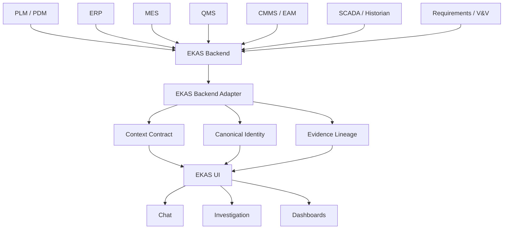

# 1 Cross-system manufacturing data

**DOCUMENTED NOW — NOT YET IMPLEMENTED IN PRODUCTION.**

Section: [2 Ownership](02-system-ownership-boundaries.md) · [3 Identity](03-canonical-ekas-identity-model.md) · [4 Resolution](04-entity-resolution.md) · [5 Lineage](05-evidence-lineage.md) · [6 Correlation](06-cross-system-correlation-rules.md) · [7 Adapter](07-adapter-normalization.md) · [8 Tests](08-integration-acceptance-tests.md) · [9 Risks](09-known-data-quality-risks.md) · [10 Roadmap](10-production-integration-roadmap.md) · [11 Product and PLM](11-product-part-identity-and-plm-context.md)

SOURCE SYSTEMS OWN FACTS. EKAS OWNS THE GOVERNED DECISION CONTEXT THAT CONNECTS THEM.

MES EXECUTES AND RECORDS. EKAS INTERPRETS, CONNECTS EVIDENCE, GOVERNS DECISIONS, AND VERIFIES OUTCOMES.

Manufacturing truth is fragmented. The plant runs on several systems of record. Each one was built to execute or to store its own transaction. None of them holds the whole decision. A planner, a maintenance technician, a quality engineer, and a plant leader can each be looking at a true record and still be unable to join those records without a person in the middle.

Chat is the primary experience. Dashboards and evidence views support Chat. They do not become a second product, and they do not turn EKAS into MES, ERP, CMMS, QMS, a historian, or PLM.

## What each system knows

| System | What it knows |
| --- | --- |
| PLM | Part, bill of materials, revision, engineering change order, effectivity |
| ERP | Production orders, inventory, suppliers, material, cost |
| MES | Work order, operation, work center, actual quantity, scrap, routing, status |
| SCADA / Historian | Values, alarms, parameters, setpoints, event time-series |
| CMMS | Asset, work order, failure history, preventive maintenance, technician notes |
| QMS | Inspections, nonconformance, 8D, CAPA, complaints, dispositions |
| Requirements / V&V | Requirements, test cases, results, failed validation, traceability |
| EKAS | Conversational context, governed evidence linking, investigation, decision workflow, verification, sustain and reopen |

A question such as "Why did Line 03 miss plan?" needs more than one of those rows. MES can say what the job produced against the plan. The historian can say what the machine did in time. CMMS can say what maintenance was open. QMS can say whether a defect or an NCR exists. PLM can say which revision and which controlled definition were effective. ERP can say which order and which material position the business held. EKAS is the place that keeps those facts attached to one governed decision: what happened, what is known, what is not known, which records support that, and what the next step is.

## System landscape

The diagram is the contract for where facts enter and where the decision is shown. It is not a claim that these connections exist on RC3.

The backend is where source facts would be read. The adapter is where they would be normalized into the context contract, the canonical identity, and the evidence lineage. The UI shows that contract in Chat first, then in Investigation and on dashboards. RC3 does not perform this read. The live adapter still fails closed for capabilities the current backend does not implement.

## What this page does not authorize

Documenting the landscape does not add a dashboard, a new chat behavior, or a write path into any source system. Source systems remain the writers of their own facts.
