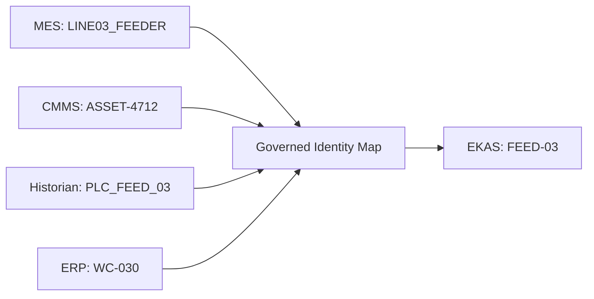

# 4 Entity resolution

**DOCUMENTED NOW — NOT YET IMPLEMENTED IN PRODUCTION.**

[Section index](01-cross-system-manufacturing-data.md)

Identity resolution is a governed map from an external system and an external id to one canonical entity. It is not a string match.

In this example the map has already been authorized. Eligible evidence that cites `LINE03_FEEDER`, `ASSET-4712`, or `PLC_FEED_03` may be read together as evidence about `FEED-03`. `WC-030` is on that same map only because the map says so, not because "03" appears in both identifiers.

## Resolve

Input: `sourceSystem` plus `sourceRecordId` or the external entity id, and the `mappingVersion` the caller is allowed to use.

Output when the map hits: `canonicalEntityId`, `kind`, `mappingVersion`, and the alias that matched.

Output when the map misses: no canonical id. The source record is preserved. The mapping state is `unresolved`. Evidence that hangs off that source id is not folded into another entity.

A second source id that looks close is a separate unresolved candidate. It is not a suggested merge.

## Aliases

The reverse read lists the source identifiers a canonical entity is allowed to carry: system, id, and the mapping version that added the alias. An alias removed by a later mapping version is not deleted from history. A lookup at the old version still shows it. A lookup at the current version does not treat it as active. See historical lookup on [14 Production backend gaps](../14-production-backend-gaps.md).

## Conflicts

| Situation | Required behavior |
| --- | --- |
| Two canonical ids claim the same source id | Preserve both claims. Mark the source id in conflict. Do not pick one. Do not combine the evidence |
| One source id and no map row | Unresolved. Ask when the user-facing answer would otherwise choose an asset, part, or job |
| Part id matches and the revision differs | Two entities. Do not inherit the other revision's BOM, effectivity, or quality record |
| The map is stale relative to `mappingVersion` on the evidence | Do not use the stale row to attach new evidence. The old evidence keeps the version it was mapped with |
| The source system is offline | The records already held stay as they were. Absence of a fresh read is reported. No substitute id is taken from another system |

## User-facing clarification

Where Chat or an investigation needs one asset, one job, or one revision and the map is unresolved or in conflict, the answer asks which record is meant. It does not choose the nearest name. This is the same discipline as an ambiguous referent: name the thing, then proceed. The RC3 product behavior for pronouns is unchanged by this page.
