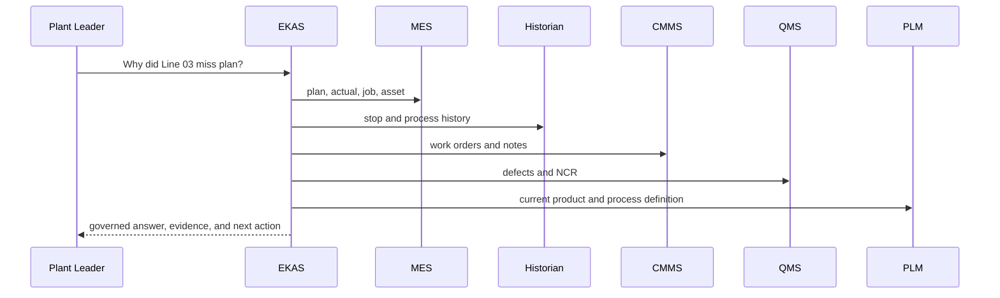

# 6 Cross-system correlation rules

**DOCUMENTED NOW — NOT YET IMPLEMENTED IN PRODUCTION.**

[Section index](01-cross-system-manufacturing-data.md)

Correlation here means a governed relationship between records that have already been identified. It does not mean a statistical join, a shared word, or events that happened in the same hour.

## Relationship types

| Type | Meaning | How it starts |
| --- | --- | --- |
| `RUN_ON` | A job or operation ran on an asset or work center | Descriptive, from a source key or a governed map |
| `PRODUCED_PART` | A run produced a part | Descriptive |
| `USED_REVISION` | A run or document used a specific part revision | Descriptive. Revision is part of the identity |
| `OBSERVED_ON` | A historian event or sample was observed on an asset | Descriptive |
| `MAINTAINED_ASSET` | A maintenance record is about an asset | Descriptive |
| `RELATED_WORK_ORDER` | A maintenance or execution work order is related to an entity | Descriptive |
| `RELATED_NCR` | A quality record is related to an entity | Descriptive |
| `CONTROLLED_BY` | A part revision or operation is controlled by a named document | Descriptive, and only while that document's controlled status and effectivity say so |
| `SUPERSEDED_BY` | A controlled record was replaced by another | Descriptive, from the source's own supersession |
| `CAUSED_BY` | A governed causal claim | Never created from correlation. It requires an explicit, authorized assertion inside the decision workflow |

Most relationships start descriptive. A descriptive relationship supports "these records are about the same governed entity." It does not support "this record caused that loss."

## Examples

| Statement | Reading |
| --- | --- |
| `JOB-8303` `RUN_ON` `FEED-03` | The job ran on the canonical asset. It does not say why the job missed plan |
| `FEED-03` `RELATED_WORK_ORDER` `WO-48213` | A maintenance work order is related to that asset. The technician notes remain notes |
| `NW-A` / `P2` `CONTROLLED_BY` `SW-030` / `FIC-D` | That revision is controlled by that standard-work document at the document's effectivity. A superseded document does not keep this as a current control |

## Sequence for a plan-miss question

This is the read a future governed answer would perform. RC3 does not call these systems.

Each arrow is a read of a source of record. A system that does not answer is named as missing. The answer is not completed by copying another system's records into the hole.

## Chat behavior for a stopping asset

Future behavior for "Why did this machine keep stopping?":

1. Resolve the selected asset through the governed map.
2. Read the MES production context for that asset.
3. Read historian events for that asset.
4. Read CMMS history for that asset.
5. Read controlled work instructions when they are relevant and still effective.
6. Read QMS when a defect, NCR, or disposition is relevant.
7. Return a governed conclusion that separates support from proof.

Example conclusion, which is the contract for the words and is not a fixture added to RC3:

> FEED-03 recorded repeated feeder-jam stops during JOB-8303. Two maintenance records mention guide wear, and the current Standard Work requires the guide/setup inspection. This supports checking guide condition and setup, but it does not yet prove root cause.

Actions offered with that answer: Show evidence, Investigate, Show related history.

If step 1 is unresolved, the conversation asks which asset is meant and does not run steps 2 through 7 against a guessed id. If a later step has no record, the conclusion says that system did not supply a record. Guide wear mentioned in a note is not a `CAUSED_BY` relationship.
