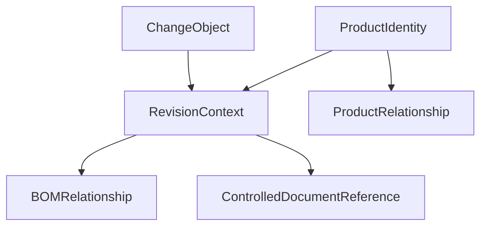
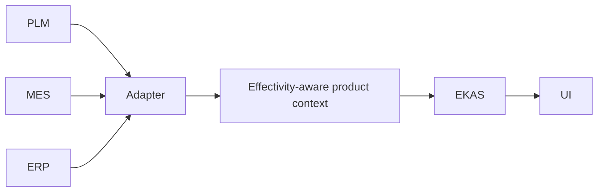

# Product / Part Identity and PLM Context

**DOCUMENTED NOW — NOT YET IMPLEMENTED IN PRODUCTION.**

[Section index](01-cross-system-manufacturing-data.md)

PLM owns the product definition. EKAS may cite the definition that was in force at the time of an event. EKAS does not release a revision, and it does not choose the newest revision because it is newest.

## Purpose

A historical job was built to a definition. That definition is a part, a revision, a controlled document, a bill, and any engineering change the source says was effective then. A later revision can already exist in PLM and still be the wrong definition for that job.

This page is the contract for that distinction. It extends the part and part-revision kinds in [3 Canonical identity](03-canonical-ekas-identity-model.md) and the PLM shape in [7 Adapter normalization](07-adapter-normalization.md). It does not change RC3 chat, and it does not add a product-data store.

## Canonical identity

Two objects carry product identity into a governed decision.

### ProductIdentity

The product or part, stable across its revisions. The source still owns the identifier it issued.

| Attribute | Meaning |
| --- | --- |
| `partId` | Part identity. Canonical only after a governed map. Otherwise the source id stays on the evidence reference |
| `sourceSystem` | The system that owns this identity. PLM for the controlled definition. MES or ERP when that system is only citing a part it used |
| `sourceRecordId` | The id in `sourceSystem` |
| `name` | The name the source states. EKAS does not tidy it into a different part |
| `unitOfMeasure` | Present only when the source states it |

A similar part number is a different ProductIdentity until a governed map says otherwise. The rule is the same as [4 Entity resolution](04-entity-resolution.md).

### RevisionContext

One controlled revision of that product, bound to a time by the source's effectivity.

| Attribute | Meaning |
| --- | --- |
| `revision` | The source's revision identifier, such as Rev B |
| `sourceVersion` | The version the source assigned to this record. A new source version is not automatically a new part revision |
| `knownAt` | When this integration knew the record |
| `effectiveFrom` | When the source says this revision or change became effective |
| `effectiveTo` | When the source says it stopped being effective. Empty means the source did not give an end |
| `lifecycleState` | The source's lifecycle word: draft, released, superseded, obsolete, or the source's own word |
| `controlledStatus` | The source's control state. EKAS does not invent it |

## Revision, version, lifecycle, and effectivity

These four words are different facts.

| Word | What it answers |
| --- | --- |
| Revision | Which controlled definition is this? Rev B and Rev C are different revisions of the same part |
| Version | Which copy of the source record is this? `sourceVersion` can move without a new part revision |
| Lifecycle | What state does the source assign now: draft, released, superseded, obsolete |
| Effectivity | During which window does the source say this revision, document, or change was in force |

Never apply the newest revision to a historical job unless the source proves effectivity.

A revision that is released after the job, or whose `effectiveFrom` is after the event, is a later definition. It stays available as a later fact. It is not the definition of the job. A superseded or obsolete lifecycle state is history. It is not promoted to current because the file is still in the vault.

## BOMRelationship

A bill line is a relationship with its own effectivity. It is not a property that floats onto every revision of the parent.

| Attribute | Meaning |
| --- | --- |
| Parent part and revision | The assembly the source names |
| Child part and revision | The component the source names |
| Quantity | The quantity the source states |
| `effectiveFrom`, `effectiveTo` | The window for this line |
| Variant | Present only when the source names a variant. A variant bill is not the base bill |
| Alternate | A separate relationship. An alternate is not used unless the source says it was the one consumed |

## ControlledDocumentReference

A drawing, a specification, or a standard-work document is a controlled record. It cites the part revision it controls, its own document revision, its `controlledStatus`, and its effectivity. A superseded drawing can be shown as the drawing that was in force on a past date. It is not shown as the current control. An obsolete drawing remains history. The correlation type `CONTROLLED_BY` in [6 Correlation](06-cross-system-correlation-rules.md) follows the same rule.

## ChangeObject

An engineering change is its own object. EKAS cites it. EKAS does not approve it.

| Kind | What the source means |
| --- | --- |
| ECR | A request for a change. A request is not an implemented definition |
| ECO | An order that releases or schedules a change, with the effectivity the source records |
| ECN | A notice of a change. The notice is not a second revision |
| Deviation | A bounded, temporary departure. It is cited beside the base revision. It does not replace that revision's identity |

Each change carries `sourceSystem`, `sourceRecordId`, `sourceVersion`, `knownAt`, `effectiveFrom`, and `effectiveTo` when the source has them. A change whose `effectiveFrom` is after the event is a future change for that event.

## ProductRelationship

Relationships between products are descriptive. They are not causes. `CAUSED_BY` is never implied from where-used, from a shared family name, or from consecutive revisions.

| Relationship | Rule |
| --- | --- |
| Where-used | The parents the source lists. Those parents do not inherit the newest revision of the child |
| Variant | Only the variant the source names |
| Alternate | Only when the source says the alternate was used |
| Supersedes | The source's successor link. The superseded record remains the record for events inside its own effectivity |

## Product model

The diagram is the contract for how these objects cite each other. It is not a claim that a product store exists on the running demo.

## PLM to EKAS

PLM remains the system of record. The adapter normalizes. EKAS holds the effectivity-aware context for the decision. MES and ERP may cite the part they executed or ordered. That citation does not overrule a conflicting PLM effectivity. Conflict stays conflict.

The request and the refusal to guess a newest revision are the [product context contract](../06-api-and-backend-integration.md).

## Future chat questions

These are questions a later conversation could ask once this contract is implemented. They are not production claims. RC3 chat does not answer them from PLM.

- Which revision of part 100-2045 was in force for JOB-8303 on 2026-03-20?
- Which controlled drawing did that revision use on that date?
- Was a deviation in force, and what window did the source give it?
- Which bill variant applied, and was an alternate consumed?
- Where was this revision used, according to the source?
- PLM and MES name different revisions. Which records are in conflict?
- The change is effective next month. What definition was in force on the day of the event?

Until the contract is implemented, the honest answer is that product context was not supplied. The newest revision is not a substitute answer.

## Acceptance tests

These tests are specified and not in the RC3 suite. None has been run. Adapter Verified stays NO. They extend [8 Integration acceptance tests](08-integration-acceptance-tests.md). A pass has to show the source ids, the effectivity window, and the revision that was bound or the refusal.

| Id | Setup | Required result |
| --- | --- | --- |
| EFF-8303 | Job JOB-8303, part 100-2045, event date 2026-03-20. Rev B effective 2026-03-01. Rev C effective 2026-05-01 | The bound revision is Rev B. Rev C is not used |
| SER-1 | A serial names a revision, and a newer part revision exists | The serial's revision is bound. The newer part revision is not substituted |
| LOT-1 | A lot carries its own revision or effectivity | That lot record is bound. A newer lot is not substituted |
| DEV-1 | A deviation is in force for that job and time | The deviation is cited with its effectivity. The base revision remains the base revision |
| SUP-1 | The controlled drawing is superseded at the event time | The superseded drawing is not presented as the definition in force |
| OBS-1 | An obsolete drawing remains in the vault | It may be shown as history. It is not selected as current |
| VAR-1 | A variant BOM applies only to a named variant | That BOM is not applied to another variant or to the base |
| ALT-1 | An alternate component exists | The alternate is not selected unless the source says it was used |
| WU-1 | Where-used is requested | The source's where-used is returned. Those parents are not moved onto the newest child revision |
| MISS-REV | The job has no revision, and effectivity does not resolve one | The result is unresolved. The newest revision is not filled in |
| PLM-MES-1 | PLM and MES name different revisions for the same job and time | Both records remain. The result is ambiguous. EKAS does not pick a winner |
| FUTURE-1 | A change has `effectiveFrom` after the event | That change is not applied to the event |
| NOPLM-1 | PLM is unavailable | The answer says PLM did not supply product context. An MES part string is not promoted to a controlled revision |
