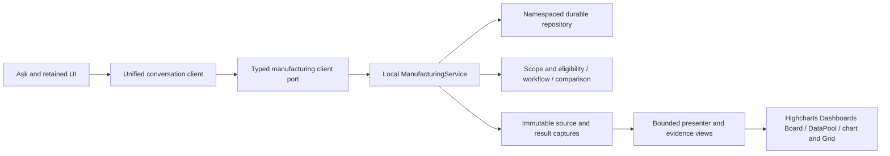

# EKAS engineering guide — working draft

This draft describes the frozen V66 synthetic prototype, ZIP SHA256 `f36a97886c213a13531b3b16a1e6fe4fd812f3cde905033836429f8d2517f788`. Release acceptance is pending. The completed V66 domain report has2,469 passes and one actual fractional-count interpretation failure. Native V66 review is separate and in progress. The V67 correction fix is working source with owner regression evidence; it is not part of V66 or an accepted release.

## Run and edit the frozen prototype

The portable package contains static assets, editable source, public exact dependency lockfile, fixtures, provenance and hash validation. From its extracted root run `python3 validate.py`, then `python3 serve.py --port 18212`. Open `http://localhost:18212/ekas/` in an owned test namespace. The server binds localhost and serves static files only. It makes no manufacturing/backend/provider dispatch. No private legacy repository or Node installation is needed for static operation.

For source editing, use the package's documented Node20.19+/22.12+ runtime with `npm ci`, `npm run build` and `npm test`. Keep frozen artifacts unchanged and work in a new source candidate. Confirm full relative test path plus assertion name retention, all85 input hashes, and the original351/55-row/35-criterion scope. A passed owner suite does not replace native/oracle acceptance.

## Current service boundary

`src/investigation/unified.ts` coordinates durable New/history transitions, the chosen fictional chat actor, same pending request sharing and exact receipt retries after a lost response. Navigation cannot append a response to another conversation. `clientPort.ts` constructs typed requests. `service.ts` owns conversation/domain staging and atomic save. `governedRecords.ts`, `dependencies.ts`, `workflow.ts`, `comparison.ts` and read-model modules validate version, source, time, scope and proof. Real authorization is not established by the fictional actor selector.

The comparison cursor has its own ID and explicit November/December clock. Returning to the original investigation retains its original context and clock. Measured result and manager acceptance are separate immutable records tied to the fingerprint; later measurements begin unaccepted. Current quality791 is a contextual trigger and never membership evidence for the separate experiment. The existing visible correction form still exposes only BASELINE-10/unit749: post-source UI correction remains an implementation gap despite service/oracle support.

`conversationalReview.ts` implements a bounded final-good correction collector. V66 incorrectly tokenizes705.5 as705. The V67 working fix reads complete tokens, checks whole-unit field semantics and explicit old-count equality, clears invalid drafts, versions interpretation, preserves old captured answers, and requires older pending drafts to be restated. Do not ship V66's collector as a released capability. Raw-unit/claim/link conversational collection remains incomplete.

`conversation.ts` and `monthlyInvestigation.ts` retain bounded dimensional/monthly and Plant Review routing. Alternate retained calculations and monthly presenter/kernel logic remain partial service-boundary work. The architecture does not yet prove that backend replacement requires only adapter work for every required flow.

## Highcharts and source integrity

Installed versions are Highcharts12.6.0, Dashboards4.2.0 and GridLite3.2.0. Native Board/DataPool/connectors/components are used for shared chart/Grid data, highlight/visibility and layouts. `EvidenceBoard.tsx`, retained `viz.tsx` and `CanonicalGapBoard.tsx` retain explicit units/source identities. Export configuration uses local libraries, empty export-server URL and disabled server fallback. New source files introduce no provider/network transport. Offline native runtime/export acceptance still requires the applicable independent browser checks; unit/configuration checks are not network observation or layout proof. No paid licence entitlement is asserted.

All data and personas are synthetic. Preserve original source anchors and known-time policy. Initial scenario is October6 14:45UTC with14:00 cutoff; performed-work/inspection evidence appears only in the explicitly later known snapshot; October20 verification, October27 sustain and November3 recurrence require explicit simulation. Approval is a decision, not performed intervention. A like-for-like repair is distinct from unreleased EC003. Historical jobs missing exposure remain unranked.

Capacity waterfall is2880−480−198−48=2154, distinct from plan2304 and gap150. Primary downtime endpoint is jam60→30 minutes per eligible shift, target≤30; speed target≤35 and quality FPY target≥95. Sustain targets differ from recurrence alarms. Observed change does not prove cause or validated savings. Six value stages retain their declared units and horizons.

## Tom's backend and OpenAI

OpenAI is the intended provider. Its future key belongs on the server. No key was read, configured, used or bundled, and no Ollama fallback exists. Current static service calls are in-process mocks.

`src/platform/pilotAdapter.ts` retains a source-derived wire boundary from read-only EKAS_Platform_v2 commit `fe2635cef64cf99eccad6c84df82bff466cb46df`: conversation creation/list, stored turns, message inputs and exact evidence identities. Exactly one message input is text, structured_request{metric,machine,window}, or clarification_answer{clarification_id,value}; message retry uses Idempotency-Key. Wire/session is explicitly injected and no synthetic session becomes a bearer token. The reference is not verified as Tom's actual target revision and does not cap the full product scope.

Actual API/schema, authenticated principal/tenant/entity/capability mapping, server policy, concurrency/error/unknown-commit semantics, streaming/cancel behavior, provider/model configuration and conformance require agreement and integration tests. Certified machine-month OEE cannot substitute for the demo's ten-shift jam/speed/FPY evidence. Map required capabilities through Tom's verified APIs; the demo's URLs are not requirements imposed on Tom. Existing pure kernels may be shared by agreement. No backend rewrite, Azure deployment or competing production server is implied.

## Review and release

The full reconciliation retains all55 service rows,35 derived criteria, three complete masters, original351 and distinct metric/conversation cohorts. Frozen original351310/41 and later historical closure322/29 with six reopened/stale entries are different evidence identities. Do not sum or regrade them as V66 passes. Completed V65 native and V66 domain reports provide bounded evidence only. Native first-Run cause/closure, mobile/keyboard/full journeys, layout/export/recovery, natural write breadth and live integration remain pending.

Original frozen R5 has Patrick's supplied independent APPROVE verdict. Separate merged DotV54 review was denied before execution and remains without an independent verdict; no retry/reroute is permitted. No real security policy, grants, dispatch, spending or workplace documents changed. Supported Library upload is unavailable; these local working drafts are not saved Library deliverables. Parent owns release delivery and review coordination.

Evidence: [V65 completed native report](/home/pat/Documents/Codex/2026-10-11/task/V65-NATIVE-ORDINARY-UI-FINAL-REPORT.md), [V66 completed domain report](/home/pat/Documents/Codex/2026-10-09/task/metric-oracle/v66-manufacturing-independent/REPORT.md). Owner regression counts and source retention provide additional bounded evidence and never replace native acceptance.
